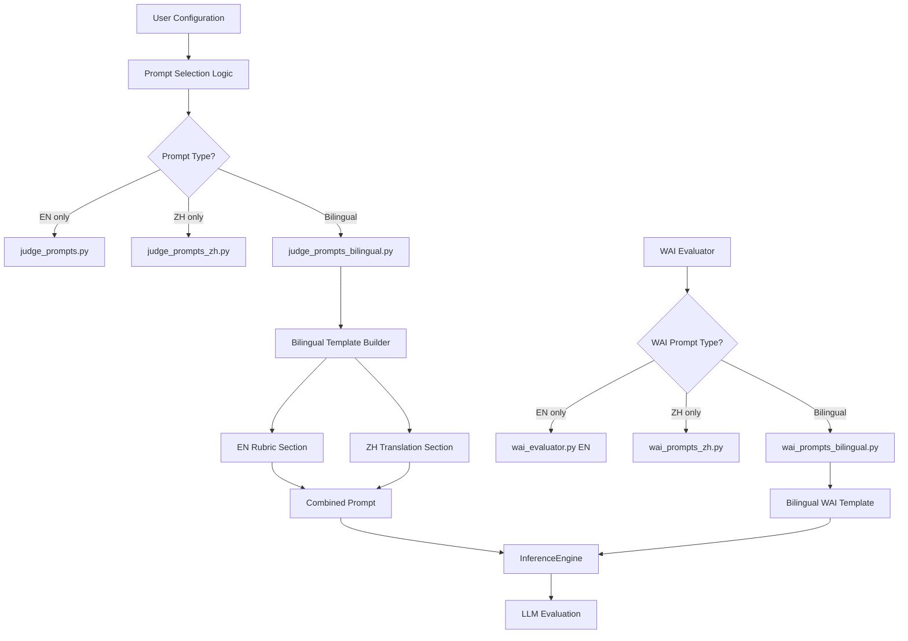
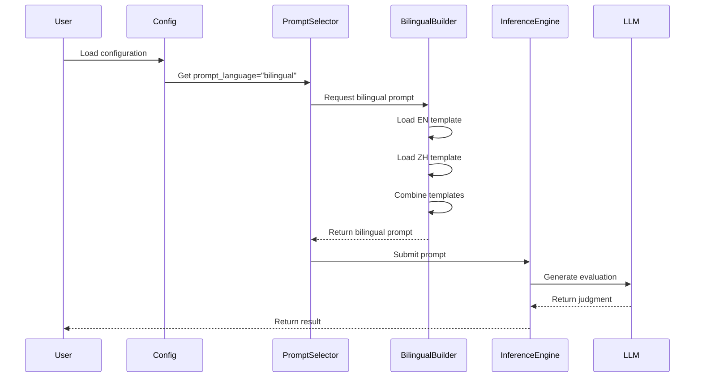

# Design Document: Bilingual Prompt Evaluation

## Overview

This feature adds a new evaluation method "Option D: Bilingual Prompt" to the mind-eval project that combines English rubrics with Chinese translations in a single prompt. The goal is to improve evaluation quality for Chinese dialogues by providing both the precise English rubric AND Chinese translation, allowing Chinese LLMs to benefit from both the detailed English criteria and their native language understanding.

The system currently has three evaluation options:
- **Option A**: English prompt with English dialogue (translated from Chinese)
- **Option B**: Chinese prompt with Chinese dialogue
- **Option C**: English prompt with Chinese dialogue

This design adds **Option D**: Bilingual prompt (EN rubric + ZH translation) with Chinese dialogue, which may provide the best of both worlds for Chinese LLM evaluators.

## Architecture



## Components and Interfaces

### Component 1: Bilingual Prompt Module

**Purpose**: Provides bilingual prompt templates combining English rubrics with Chinese translations

**Interface**:
```python
# judge_prompts_bilingual.py

from string import Template

def build_bilingual_prompt(
    en_template: Template,
    zh_template: Template,
    **kwargs
) -> str:
    """
    Combine English and Chinese prompt templates into a bilingual prompt.
    
    Args:
        en_template: English prompt template
        zh_template: Chinese prompt template
        **kwargs: Template variables (conversation_str, name, etc.)
    
    Returns:
        Combined bilingual prompt string
    """
    pass

JUDGE_PROMPT_TEMPLATE_BILINGUAL: Template
```

**Responsibilities**:
- Combine English and Chinese prompt templates
- Maintain proper formatting and structure
- Ensure all template variables are properly substituted
- Provide clear section markers for EN and ZH content

### Component 2: WAI Bilingual Prompt Module

**Purpose**: Provides bilingual prompts for WAI (Working Alliance Inventory) evaluation

**Interface**:
```python
# wai_prompts_bilingual.py

QUESTIONS_BILINGUAL: dict[str, dict[str, str]]  # {"Q1": {"en": "...", "zh": "..."}}
DETAILED_GUIDELINES_BILINGUAL: dict[str, dict[str, str]]
PROMPT_TEMPLATE_BILINGUAL: str

def build_prompt_bilingual(qid: str, conversation: str) -> str:
    """
    Construct bilingual Detailed-Guidelines + CoT prompt for one WAI question.
    
    Args:
        qid: Question ID (Q1-Q12)
        conversation: The dialogue text
    
    Returns:
        Fully-formatted bilingual prompt
    """
    pass
```

**Responsibilities**:
- Combine WAI questions in both languages
- Merge detailed guidelines from English and Chinese versions
- Maintain the Chain-of-Thought (CoT) structure
- Ensure proper JSON output format instructions

### Component 3: Configuration Extension

**Purpose**: Extend configuration to support bilingual prompt selection

**Interface**:
```python
# config.py (extension)

class PromptLanguage(Enum):
    EN = "en"
    ZH = "zh"
    BILINGUAL = "bilingual"

def get_prompt_language(config: dict) -> PromptLanguage:
    """
    Extract prompt language preference from configuration.
    
    Args:
        config: Configuration dictionary
    
    Returns:
        PromptLanguage enum value
    """
    pass
```

**Responsibilities**:
- Define prompt language options
- Parse configuration for prompt language preference
- Provide default values
- Validate configuration

### Component 4: Prompt Selection Logic

**Purpose**: Route to appropriate prompt template based on configuration

**Interface**:
```python
# inference.py (extension)

def select_judge_prompt(
    prompt_language: PromptLanguage
) -> Template:
    """
    Select appropriate judge prompt template based on language preference.
    
    Args:
        prompt_language: Desired prompt language
    
    Returns:
        Prompt template
    """
    pass

def select_wai_prompt_builder(
    prompt_language: PromptLanguage
) -> callable:
    """
    Select appropriate WAI prompt builder function.
    
    Args:
        prompt_language: Desired prompt language
    
    Returns:
        Prompt builder function
    """
    pass
```

**Responsibilities**:
- Import appropriate prompt modules
- Return correct template or builder function
- Handle missing or invalid configurations
- Maintain backward compatibility

## Data Models

### Model 1: BilingualPromptConfig

```python
from dataclasses import dataclass
from typing import Optional

@dataclass
class BilingualPromptConfig:
    """Configuration for bilingual prompt generation."""
    
    prompt_language: str  # "en", "zh", or "bilingual"
    section_separator: str = "\n\n---\n\n"
    include_language_labels: bool = True
    en_section_label: str = "## English Rubric"
    zh_section_label: str = "## 中文翻译 (Chinese Translation)"
```

**Validation Rules**:
- `prompt_language` must be one of: "en", "zh", "bilingual"
- `section_separator` must be non-empty string
- Labels should be clear and distinguishable

### Model 2: WAIBilingualQuestion

```python
from dataclasses import dataclass

@dataclass
class WAIBilingualQuestion:
    """Bilingual WAI question with English and Chinese versions."""
    
    qid: str  # Q1-Q12
    question_en: str
    question_zh: str
    guideline_en: str
    guideline_zh: str
    
    def format_bilingual(self) -> str:
        """Format as bilingual question block."""
        pass
```

**Validation Rules**:
- `qid` must match pattern Q[1-12]
- All text fields must be non-empty
- English and Chinese versions must convey same meaning

## Main Algorithm/Workflow



## Key Functions with Formal Specifications

### Function 1: build_bilingual_prompt()

```python
def build_bilingual_prompt(
    en_template: Template,
    zh_template: Template,
    **kwargs
) -> str:
    """
    Combine English and Chinese prompt templates into a bilingual prompt.
    
    Args:
        en_template: English prompt template with ${variables}
        zh_template: Chinese prompt template with ${variables}
        **kwargs: Template substitution variables
    
    Returns:
        Combined bilingual prompt string
    
    Raises:
        ValueError: If templates have mismatched variables
        KeyError: If required template variables are missing
    """
```

**Preconditions:**
- `en_template` is a valid Template object with defined variables
- `zh_template` is a valid Template object with same variables as en_template
- `kwargs` contains all required template variables
- All template variables in kwargs are non-null

**Postconditions:**
- Returns non-empty string
- Result contains both English and Chinese sections
- All template variables are substituted
- Section separators are properly inserted
- No template variable placeholders remain in output

**Loop Invariants:** N/A (no loops in this function)

### Function 2: build_prompt_bilingual()

```python
def build_prompt_bilingual(qid: str, conversation: str) -> str:
    """
    Construct bilingual WAI prompt for one question.
    
    Args:
        qid: Question ID (Q1-Q12)
        conversation: Dialogue text
    
    Returns:
        Formatted bilingual prompt
    
    Raises:
        KeyError: If qid is not in valid range Q1-Q12
        ValueError: If conversation is empty
    """
```

**Preconditions:**
- `qid` matches pattern "Q[1-9]" or "Q1[0-2]"
- `conversation` is non-empty string
- QUESTIONS_BILINGUAL and DETAILED_GUIDELINES_BILINGUAL are properly initialized

**Postconditions:**
- Returns non-empty formatted prompt string
- Prompt contains both English and Chinese question text
- Prompt contains both English and Chinese guidelines
- Prompt includes proper JSON output format instructions
- Conversation text is properly embedded in prompt

**Loop Invariants:** N/A

### Function 3: select_judge_prompt()

```python
def select_judge_prompt(prompt_language: PromptLanguage) -> Template:
    """
    Select appropriate judge prompt template.
    
    Args:
        prompt_language: Desired prompt language
    
    Returns:
        Prompt template object
    
    Raises:
        ValueError: If prompt_language is invalid
        ImportError: If required prompt module cannot be loaded
    """
```

**Preconditions:**
- `prompt_language` is a valid PromptLanguage enum value
- Required prompt modules (judge_prompts.py, judge_prompts_zh.py, judge_prompts_bilingual.py) exist

**Postconditions:**
- Returns valid Template object
- Template corresponds to requested language
- Template contains all required variable placeholders
- No side effects on global state

**Loop Invariants:** N/A

## Algorithmic Pseudocode

### Main Processing Algorithm

```pascal
ALGORITHM process_bilingual_evaluation(conversation, member_details, config)
INPUT: conversation (dialogue text), member_details (dict), config (dict)
OUTPUT: evaluation_result (dict with scores)

BEGIN
  ASSERT config is not null
  ASSERT conversation is non-empty
  
  // Step 1: Determine prompt language from config
  prompt_language ← get_prompt_language(config)
  
  IF prompt_language = "bilingual" THEN
    // Step 2: Load bilingual prompt template
    IF evaluation_type = "judge" THEN
      template ← load_bilingual_judge_template()
    ELSE IF evaluation_type = "wai" THEN
      template ← load_bilingual_wai_template()
    END IF
    
    // Step 3: Build prompt with conversation and member details
    prompt ← build_prompt(template, conversation, member_details)
    
    ASSERT prompt contains both EN and ZH sections
  ELSE
    // Fall back to existing single-language logic
    prompt ← build_single_language_prompt(prompt_language, conversation, member_details)
  END IF
  
  // Step 4: Submit to LLM for evaluation
  result ← inference_engine.generate(prompt)
  
  // Step 5: Parse and return result
  evaluation_result ← parse_evaluation_result(result)
  
  ASSERT evaluation_result contains all required scores
  
  RETURN evaluation_result
END
```

**Preconditions:**
- conversation is non-empty string
- member_details contains all required fields
- config contains valid prompt_language setting
- inference_engine is properly initialized

**Postconditions:**
- evaluation_result contains all required evaluation scores
- All scores are within valid ranges
- Result format matches expected schema

**Loop Invariants:** N/A (no loops in main algorithm)

### Bilingual Template Construction Algorithm

```pascal
ALGORITHM build_bilingual_template(en_template, zh_template, separator)
INPUT: en_template (Template), zh_template (Template), separator (string)
OUTPUT: bilingual_template (Template)

BEGIN
  ASSERT en_template is not null
  ASSERT zh_template is not null
  ASSERT separator is non-empty
  
  // Step 1: Extract template strings
  en_string ← en_template.template
  zh_string ← zh_template.template
  
  // Step 2: Verify variable consistency
  en_vars ← extract_variables(en_string)
  zh_vars ← extract_variables(zh_string)
  
  IF en_vars ≠ zh_vars THEN
    RAISE ValueError("Template variables mismatch")
  END IF
  
  // Step 3: Construct bilingual template string
  bilingual_string ← ""
  bilingual_string ← bilingual_string + "## English Rubric\n\n"
  bilingual_string ← bilingual_string + en_string
  bilingual_string ← bilingual_string + separator
  bilingual_string ← bilingual_string + "## 中文翻译 (Chinese Translation)\n\n"
  bilingual_string ← bilingual_string + zh_string
  
  // Step 4: Create new template
  bilingual_template ← Template(bilingual_string)
  
  ASSERT bilingual_template contains all variables from en_vars
  
  RETURN bilingual_template
END
```

**Preconditions:**
- en_template and zh_template are valid Template objects
- Both templates have same set of variables
- separator is non-empty string

**Postconditions:**
- bilingual_template is valid Template object
- Contains both English and Chinese sections
- All variables from input templates are preserved
- Section labels are properly inserted

**Loop Invariants:** N/A

## Example Usage

```python
# Example 1: Basic bilingual evaluation setup
from mindeval.judge_prompts_bilingual import JUDGE_PROMPT_TEMPLATE_BILINGUAL
from mindeval.inference import InferenceEngine

# Configure for bilingual prompts
config = {
    "judge": {
        "model": "gpt-4",
        "api_key": "...",
        "prompt_language": "bilingual"  # New configuration option
    }
}

# Create inference engine
engine = InferenceEngine(config["judge"])

# Build bilingual prompt
prompt = JUDGE_PROMPT_TEMPLATE_BILINGUAL.substitute(
    name="Amy",
    conversation_str="<therapist>Hi Amy...</therapist>...",
    # ... other member details
)

# Generate evaluation
result = engine.generate([{"role": "user", "content": prompt}])

# Example 2: WAI bilingual evaluation
from mindeval.wai.wai_prompts_bilingual import build_prompt_bilingual

# Build bilingual WAI prompt for question Q1
conversation = "咨询师与来访者的对话..."
prompt = build_prompt_bilingual("Q1", conversation)

# Evaluate
result = engine.generate([{"role": "user", "content": prompt}])

# Example 3: Configuration-based prompt selection
from mindeval.config import get_prompt_language, PromptLanguage
from mindeval.inference import select_judge_prompt

# Load configuration
prompt_lang = get_prompt_language(config)

# Select appropriate template
if prompt_lang == PromptLanguage.BILINGUAL:
    template = select_judge_prompt(prompt_lang)
    # Use bilingual template
else:
    # Use single-language template
    template = select_judge_prompt(prompt_lang)
```

## Correctness Properties

### Property 1: Template Variable Consistency
**Statement**: For all bilingual prompts, the set of template variables in the English section must equal the set of template variables in the Chinese section.

**Formal**: ∀ bilingual_prompt: variables(EN_section) = variables(ZH_section)

### Property 2: Content Preservation
**Statement**: When a bilingual prompt is constructed from English and Chinese templates, all content from both templates must be present in the output.

**Formal**: ∀ en_template, zh_template: content(bilingual_prompt) ⊇ content(en_template) ∪ content(zh_template)

### Property 3: Section Separation
**Statement**: Bilingual prompts must contain clear section markers separating English and Chinese content.

**Formal**: ∀ bilingual_prompt: contains(bilingual_prompt, EN_marker) ∧ contains(bilingual_prompt, ZH_marker) ∧ position(EN_marker) < position(ZH_marker)

### Property 4: Variable Substitution Completeness
**Statement**: After template substitution, no template variable placeholders should remain in the output.

**Formal**: ∀ bilingual_prompt, kwargs: substitute(bilingual_prompt, kwargs) ⟹ ¬contains(output, "${")

### Property 5: Backward Compatibility
**Statement**: Existing single-language evaluation modes (EN only, ZH only) must continue to function unchanged when bilingual mode is added.

**Formal**: ∀ config: (config.prompt_language ∈ {"en", "zh"}) ⟹ behavior(new_system) = behavior(old_system)

### Property 6: WAI Question Coverage
**Statement**: All 12 WAI questions (Q1-Q12) must have bilingual versions with both English and Chinese text.

**Formal**: ∀ qid ∈ {Q1, Q2, ..., Q12}: ∃ question_en, question_zh, guideline_en, guideline_zh

### Property 7: Output Format Consistency
**Statement**: Bilingual prompts must produce evaluation outputs in the same format as single-language prompts.

**Formal**: ∀ prompt_type ∈ {en, zh, bilingual}: schema(output(prompt_type)) = standard_schema

## Error Handling

### Error Scenario 1: Missing Template Variables

**Condition**: Template substitution is attempted with incomplete kwargs
**Response**: Raise KeyError with clear message indicating missing variables
**Recovery**: Log error, fall back to single-language prompt if possible, or abort evaluation

### Error Scenario 2: Template Variable Mismatch

**Condition**: English and Chinese templates have different sets of variables
**Response**: Raise ValueError during template construction
**Recovery**: Log error, use single-language template, notify developer of template inconsistency

### Error Scenario 3: Invalid Prompt Language Configuration

**Condition**: Configuration specifies unsupported prompt language
**Response**: Raise ValueError with list of valid options
**Recovery**: Fall back to default language (English), log warning

### Error Scenario 4: Missing Bilingual Prompt Module

**Condition**: Bilingual mode is requested but module cannot be imported
**Response**: Raise ImportError with helpful message
**Recovery**: Fall back to single-language mode, log error

### Error Scenario 5: Invalid WAI Question ID

**Condition**: build_prompt_bilingual() called with qid outside Q1-Q12
**Response**: Raise KeyError with valid range information
**Recovery**: Log error, skip this question in evaluation

## Testing Strategy

### Unit Testing Approach

**Test Coverage Goals**: 90%+ code coverage for new modules

**Key Test Cases**:

1. **Template Construction Tests**
   - Test bilingual template creation with valid EN/ZH templates
   - Test variable extraction and consistency checking
   - Test section separator insertion
   - Test label formatting

2. **Prompt Building Tests**
   - Test build_bilingual_prompt() with complete kwargs
   - Test error handling for missing variables
   - Test output format and structure
   - Test special characters and Unicode handling

3. **WAI Bilingual Tests**
   - Test build_prompt_bilingual() for all Q1-Q12
   - Test question and guideline formatting
   - Test JSON output format instructions
   - Test conversation embedding

4. **Configuration Tests**
   - Test get_prompt_language() with various configs
   - Test default value handling
   - Test invalid configuration handling
   - Test enum validation

5. **Prompt Selection Tests**
   - Test select_judge_prompt() for all language options
   - Test select_wai_prompt_builder() routing
   - Test module import handling
   - Test backward compatibility

### Property-Based Testing Approach

**Property Test Library**: hypothesis (Python)

**Properties to Test**:

1. **Template Variable Consistency Property**
   ```python
   @given(en_template=templates(), zh_template=templates())
   def test_variable_consistency(en_template, zh_template):
       # Assume templates have same variables
       bilingual = build_bilingual_template(en_template, zh_template)
       assert extract_vars(bilingual) == extract_vars(en_template)
   ```

2. **Content Preservation Property**
   ```python
   @given(en_content=text(), zh_content=text())
   def test_content_preservation(en_content, zh_content):
       bilingual = combine_content(en_content, zh_content)
       assert en_content in bilingual and zh_content in bilingual
   ```

3. **Substitution Completeness Property**
   ```python
   @given(template=templates(), kwargs=dictionaries())
   def test_no_placeholders_remain(template, kwargs):
       # Assume kwargs contains all required variables
       result = template.substitute(kwargs)
       assert "${" not in result
   ```

### Integration Testing Approach

**Integration Test Scenarios**:

1. **End-to-End Bilingual Evaluation**
   - Load configuration with bilingual setting
   - Build bilingual prompt with real conversation data
   - Submit to mock LLM
   - Verify output format and scores

2. **WAI Bilingual Evaluation Pipeline**
   - Test complete WAI evaluation with bilingual prompts
   - Verify all 12 questions are processed
   - Check dimension score calculations
   - Validate output format

3. **Configuration Integration**
   - Test switching between EN, ZH, and bilingual modes
   - Verify correct prompt selection
   - Check backward compatibility with existing configs

4. **Module Import Integration**
   - Test dynamic import of bilingual modules
   - Verify fallback behavior when modules missing
   - Check error propagation

## Performance Considerations

### Token Usage
- Bilingual prompts will use approximately 2x tokens compared to single-language prompts
- Estimate: ~4000-6000 tokens per evaluation (vs ~2000-3000 for single-language)
- Cost impact: Proportional increase in API costs
- Mitigation: Make bilingual mode opt-in, provide clear documentation of cost implications

### Response Time
- Increased token count may lead to slightly longer generation times
- Estimate: 10-20% increase in latency
- Mitigation: Use batch processing where possible, consider caching for repeated evaluations

### Memory Usage
- Additional prompt templates loaded in memory
- Impact: Minimal (~100KB additional memory per template)
- Mitigation: Lazy loading of bilingual modules only when needed

## Security Considerations

### Input Validation
- Validate all template variables before substitution
- Sanitize conversation text to prevent prompt injection
- Validate configuration values against allowed options

### API Key Protection
- Ensure bilingual mode doesn't expose API keys in logs
- Maintain same security practices as existing modes
- No additional API endpoints or external dependencies

### Data Privacy
- Bilingual prompts don't introduce new data privacy concerns
- Same conversation data handling as existing modes
- No additional data storage or transmission

## Dependencies

### Required Python Packages
- `string.Template` (standard library) - for template handling
- `enum.Enum` (standard library) - for configuration enums
- `dataclasses` (standard library) - for data models
- `litellm` (existing) - for LLM API calls

### Internal Dependencies
- `mindeval.judge_prompts` - English prompt templates
- `mindeval.judge_prompts_zh` - Chinese prompt templates
- `mindeval.wai.wai_evaluator` - WAI evaluation logic
- `mindeval.wai.wai_prompts_zh` - WAI Chinese prompts
- `mindeval.inference` - InferenceEngine for LLM calls
- `mindeval.config` - Configuration handling

### New Modules to Create
- `mindeval.judge_prompts_bilingual` - Bilingual judge prompts
- `mindeval.wai.wai_prompts_bilingual` - Bilingual WAI prompts
- `mindeval.config` (extension) - Add PromptLanguage enum and helpers

### External Dependencies
- None (no new external packages required)

### Configuration Files
- `config.json` - Add `prompt_language` field to judge and translation sections
- Example:
  ```json
  {
    "judge": {
      "model": "gpt-4",
      "prompt_language": "bilingual"
    }
  }
  ```
