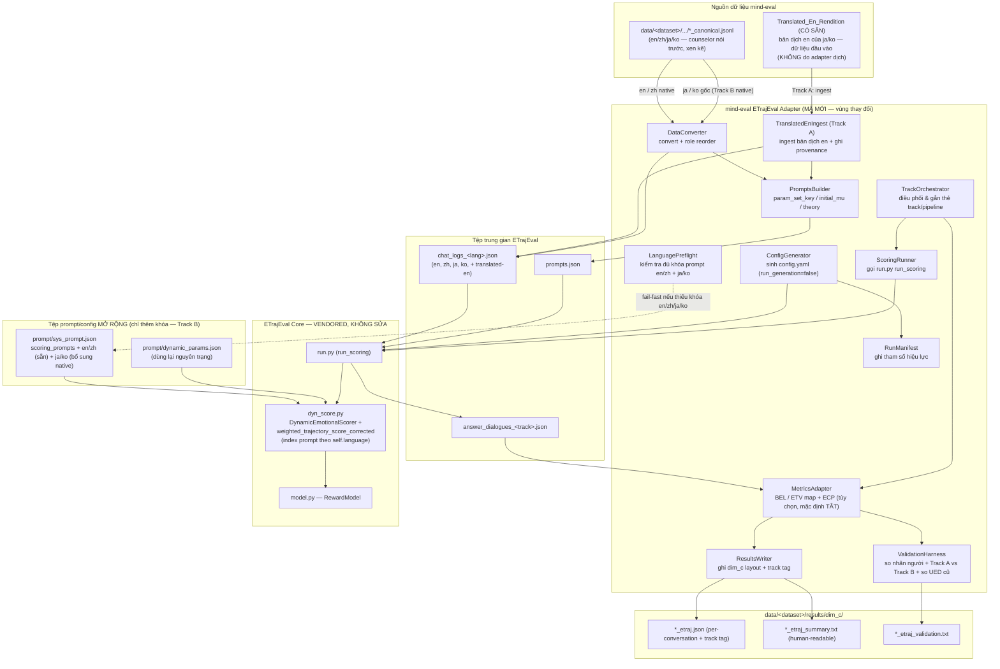

# Tài liệu Thiết kế (Design Document)

## Overview

Tính năng `dim-c-etrajeval-scoring` thay thế phương pháp đánh giá **Chiều C** dựa trên từ điển (UED / NRC-VAD) bằng phương pháp chấm điểm quỹ đạo cảm xúc **lấy thân chủ làm trung tâm** dựa trên mô hình, theo bài báo ETrajEval. Nguyên tắc chủ đạo, xuyên suốt mọi quyết định thiết kế, là **ràng buộc cốt lõi của Requirement 1**:

> Mã lõi scorer/metric của ETrajEval được **vendor (tích hợp) NGUYÊN VẸN, KHÔNG SỬA ĐỔI**. Toàn bộ công việc đặc thù cho mind-eval chỉ nằm ở một lớp **adapter mỏng** + cấu hình + mở rộng tệp prompt + tích hợp kết quả.

Vì vậy, thiết kế này được tổ chức quanh một **đường nối (seam) rõ ràng** giữa hai vùng:

- **Vùng VENDORED (bất khả xâm phạm):** `ETrajEval/dyn_score.py` (`DynamicEmotionalScorer`, `weighted_trajectory_score_corrected`), `ETrajEval/model.py` (`RewardModel`), `ETrajEval/run.py` (điều phối). Các tệp này được sao chép y nguyên từ kho gốc (Apache-2.0). **Không một dòng logic nào được sửa.**
- **Vùng ADAPTER (mã mới của mind-eval):** chuyển đổi dữ liệu, sinh cấu hình, mở rộng prompt theo ngôn ngữ, gọi `run.py`, đọc kết quả và ghi vào layout Chiều C, kèm harness xác thực.

Thiết kế chỉ dùng **pha `run_scoring`** của ETrajEval (Requirement 2): `run_generation=false`, nạp hội thoại có sẵn từ `scoring.input_chat_log_file` (Requirement 2).

### Chiến lược đa ngôn ngữ (Requirement 6) — tóm tắt

- **`en` / `zh` — bản địa (native):** chấm bằng các mục prompt `en`/`zh` đã có sẵn của Core, không sửa core.
- **`ja` / `ko` — HAI track song song**, đều được tạo và lưu lại để so sánh đa góc nhìn:
  - **Track A (translated-en):** ingest **bản dịch tiếng Anh CÓ SẴN** (pre-existing input dataset) rồi chấm qua pipeline `en`. **Adapter KHÔNG dịch**; chỉ tiếp nhận và ghi nguồn/provenance (R6.4/R6.5).
  - **Track B (native ja/ko):** thêm mục prompt `ja`/`ko` vào `sys_prompt.json` (extension, không sửa core) rồi chấm trực tiếp văn bản `ja`/`ko` gốc (R6.6/R6.7).
- Mỗi kết quả được **gắn thẻ track/pipeline** (`en` | `zh` | `translated-en` | `native-ja` | `native-ko`) để diễn giải và so sánh (R6.10/R6.11).

### Phạm vi truy vết yêu cầu (Requirement traceability map)

| Requirement | Mục thiết kế chính |
|---|---|
| R1 — Vendor không sửa đổi | Architecture (seam), Components §Vendored Core, Design Decisions |
| R2 — Chỉ run_scoring | Architecture (data flow), §ConfigGenerator, §ScoringRunner |
| R3 — Adapter chuyển đổi | §DataConverter, Data Models, Error Handling, Correctness Properties 1–4 |
| R4 — param_set_key / initial_mu | §DataConverter (PromptsBuilder), Data Models, Property 5 |
| R5 — Xuất chỉ số + tích hợp layout | §ResultsWriter, §MetricsAdapter (ECP tùy chọn, mặc định TẮT), Data Models, Properties 6–8 |
| R6 — Đa ngôn ngữ: en/zh bản địa; ja/ko hai track (Track A translated-en + Track B native) | §TranslatedEnIngest (Track A), §PromptExtension + native scoring (Track B), §LanguagePreflight (en/zh + ja/ko), §TrackOrchestrator (gắn thẻ track), Properties 10–12, Design Decisions |
| R7 — Xác thực chất lượng (so nhãn; so sánh Track A vs Track B cho ja/ko) | §ValidationHarness, Testing Strategy |
| R8 — Tái lập & cấu hình | §ConfigGenerator, §RunManifest, Error Handling, Design Decisions |

## Architecture

### Sơ đồ thành phần và luồng dữ liệu



### Nguyên tắc đường nối (seam) giữa vendored core và adapter

1. **Hướng phụ thuộc một chiều:** Adapter phụ thuộc vào Core (gọi `run.py`, đọc/ghi các tệp I/O của nó). Core **không bao giờ** phụ thuộc ngược vào adapter. Điều này giúp có thể cập nhật/đối chiếu lại với kho gốc bất cứ lúc nào.
2. **Giao tiếp qua tệp, không qua sửa code:** Adapter và Core chỉ trao đổi qua các artefact trên đĩa đã được ETrajEval định nghĩa sẵn: `chat_logs_<lang>.json`, `prompts.json`, `config.yaml`, `answer_dialogues_<lang>.json`. Không monkey-patch, không sửa chữ ký hàm.
3. **Mở rộng prompt là "thêm mục", không "đổi logic":** Đa ngôn ngữ (R6) chỉ thêm khóa `ja`/`ko` vào cấu trúc đã có trong `sys_prompt.json`. Cấu trúc và cách `DynamicEmotionalScorer` đọc prompt giữ nguyên.
4. **Bảo vệ ràng buộc bằng kiểm thử & quy ước:** Một test "core integrity" (checksum/so sánh với bản gốc) xác nhận các tệp lõi không bị chỉnh sửa nội dung logic (R1.2, R1.4). Mọi tùy biến không lọt được vào core sẽ buộc phải nằm ở adapter (R1.3).

### Bố cục thư mục đề xuất

```
mind-eval/
  vendor/etrajeval/            # VENDORED nguyên trạng (Apache-2.0)
    ETrajEval/
      dyn_score.py             # KHÔNG SỬA
      model.py                 # KHÔNG SỬA
      run.py                   # KHÔNG SỬA
    prompt/
      sys_prompt.json          # MỞ RỘNG (thêm khóa ja/ko) — xem R6
      dynamic_params.json      # dùng lại nguyên trạng
    LICENSE                    # Apache-2.0 giữ nguyên (R1.5, R8.4)
    NOTICE / ATTRIBUTION.md    # ghi nguồn ETrajEval
  src/dim_c_etraj/             # ADAPTER (mã mới)
    converter.py               # DataConverter + PromptsBuilder
    translated_en_ingest.py    # TranslatedEnIngest (Track A) — ingest bản dịch en CÓ SẴN
    config_gen.py              # ConfigGenerator + RunManifest
    preflight.py               # LanguagePreflight (en/zh + ja/ko Track B)
    prompt_extension.py        # PromptExtension (thêm khóa ja/ko native vào sys_prompt.json)
    runner.py                  # ScoringRunner
    orchestrator.py            # TrackOrchestrator (điều phối + gắn thẻ track/pipeline)
    metrics.py                 # MetricsAdapter (BEL/ETV/ECP)
    results_writer.py          # ResultsWriter
    validation.py              # ValidationHarness
    cli.py                     # điểm vào dòng lệnh
  config/dim_c_etraj.yaml      # cấu hình phía mind-eval
```

## Components and Interfaces

### Vùng VENDORED (chỉ mô tả, không thiết kế lại)

**ETrajEval Core** được dùng như hộp đen có hợp đồng I/O cố định:

- `run.py` ở pha `run_scoring`: đọc `scoring.input_chat_log_file` (danh sách `{id, conversations, ...}`) và `data.prompt_file` (`prompts.json` cung cấp theo id: `param_set_key`, `initial_mu`, `psychological_theory`). Chỉ chấm các id xuất hiện trong `prompts.json`.
- Với mỗi hội thoại gọi `DynamicEmotionalScorer.analyze_conversation_and_get_trajectory(conversation_log, reward_model, k_samples, softmax_temperature, param_set_key, initial_mu)`.
- Tính `turn_scores`; `weighted_score = weighted_trajectory_score_corrected(turn_scores, param_set_key)` (= ETV); `avg_sentiment = mean(turn_scores)` (= BEL). Ghi `answer_dialogues_<language>.json` gồm `metadata.overall_summary`, `theory_breakdown`, và per-conversation `scoring_results.turn_scores` (mỗi phần tử có `turn_index`, `subject_turn_number`, `average_sentiment_score`, `sentiment_label`).
- `DynamicEmotionalScorer` coi `conversation_log[0]['role']` là **subject (thân chủ)** và `conversation_log[1]['role']` là assistant; chỉ chấm các lượt subject. Lượt subject đầu tiên: không lấy mẫu, dùng mô tả trung tính cố định. Các lượt sau: lấy k mẫu từ `Normal(mu, sigma)` với mu/sigma suy giảm theo lượt (điều chỉnh nhân quả do(S_{t-1})), với mỗi mẫu ánh xạ điểm → mô tả cảm xúc, ghép lịch sử `conversation_log[:original_index]` + mô tả + reply vào `main_template`, truy vấn `RewardModel` (positive_eval vs negative_eval), softmax theo nhiệt độ trên cặp logit → điểm [0,1], lấy trung bình k.
- `weighted_trajectory_score_corrected`: `weight = 1 - score_prev`, `diff = score_curr - score_prev`; skip_indices: `medium_20_turns` bỏ 21; `fast_10_turns` bỏ 11/21/31; `slow_40_turns` không bỏ.

> **Adapter không được tái hiện hay sửa các hành vi trên.** Adapter chỉ chuẩn bị đầu vào sao cho khớp các giả định này (đặc biệt là giả định "subject = phần tử [0]"), và đọc đầu ra.

### Vùng ADAPTER (mã mới)

#### DataConverter (R3, R4)

Chuyển một tệp `*_canonical.jsonl` thành `chat_logs_<lang>.json` của ETrajEval.

```python
@dataclass
class ConversionConfig:
    default_param_set_key: str = "slow_40_turns"   # R4.1
    default_initial_mu: float = -2.0               # R4.2
    param_set_key_override: str | None = None       # R4.3
    initial_mu_override: float | None = None        # R4.3
    theory_field: str = "extra.topic_group"         # nguồn suy ra psychological_theory
    theory_default: str = "N/A"

@dataclass
class SkipRecord:
    interaction_id: str
    reason: str          # "missing_field" | "empty_interaction" | "no_client_turn" | ...

@dataclass
class ConversionResult:
    chat_logs: dict[str, list[dict]]    # lang -> list of {id, conversations, source_meta}
    prompts: dict[str, dict]            # id -> {param_set_key, initial_mu, psychological_theory}
    skipped: list[SkipRecord]           # R3.6
    errors: list[SkipRecord]            # R3.7

class DataConverter:
    def convert_file(self, path: str, cfg: ConversionConfig) -> ConversionResult: ...
    def _reorder_roles(self, interaction: list[dict]) -> list[dict] | None: ...
    def _split_by_language(self, records) -> dict[str, list]: ...  # dùng metadata.language (R5.5)
```

Hành vi chính:
- **Ánh xạ id:** `interaction_id` → `id` (R3.9) để truy vết.
- **Tách theo ngôn ngữ:** dùng `metadata.language` để sinh `chat_logs_<lang>.json` riêng (R5.5/R6).
- **Role reorder:** xem §"Thiết kế xử lý subject/role" bên dưới (R3.2/R3.3/R3.4).
- **Thành công một phần:** mỗi hội thoại được xử lý độc lập; lỗi/skip một hội thoại không dừng cả tệp (R3.6–R3.8). Nếu chỉ tạo được một trong hai tệp đầu ra cho một phần dữ liệu thì vẫn ghi tệp khả thi và tiếp tục.

#### PromptsBuilder (R4)

Sinh `prompts.json`. Với mỗi `id`:
- `param_set_key`: `override` nếu có (R4.3), ngược lại mặc định `slow_40_turns` (R4.1 — hội thoại thực không có sự kiện nhiễu tổng hợp nên không bỏ lượt nào).
- `initial_mu`: `override` nếu có, ngược lại mặc định `-2.0` được ghi tài liệu (R4.2/R4.3). Không dùng giá trị ngẫu nhiên khác.
- `psychological_theory`: suy từ `extra.topic_group` (vd `"exercise"`); nếu thiếu → `"N/A"` (R5.6).
- Mọi giá trị hiệu lực được PromptsBuilder phát ra cũng được RunManifest ghi lại (R4.4).

#### ConfigGenerator + RunManifest (R2, R8)

```python
@dataclass
class ScoringConfig:
    reward_model_path: str
    reward_model_device: str = "cuda:0"
    k_samples: int = 8                 # R8.2 default
    softmax_temperature: float = 10.0  # R8.2 default
    language: str                      # 'en' | 'zh' | 'ja' | 'ko' (mục prompt Core đọc theo self.language)
    track: str                         # 'en'|'zh'|'translated-en'|'native-ja'|'native-ko' (R6.11)
    input_chat_log_file: str
    prompt_file: str
    compute_ecp: bool = False          # R5.4 — ECP tùy chọn, mặc định TẮT

class ConfigGenerator:
    def write_etraj_config(self, sc: ScoringConfig, out_path: str) -> None:
        # luôn đặt execution_phases.run_generation=false, run_scoring=true (R2.1)
        ...

class RunManifest:
    def record(self, effective_params: dict, per_conv_params: dict) -> None:  # R4.4, R8.5
        ...
```

ConfigGenerator sinh `config.yaml` của ETrajEval với `run_generation=false, run_scoring=true`, ánh xạ các khóa cấu hình mind-eval (R8.1) sang `scoring.*`. Khi không cấu hình `k_samples`/`softmax_temperature` thì dùng mặc định 8 / 10 (R8.2). RunManifest ghi lại đường dẫn reward model, k_samples, softmax_temperature, device cùng kết quả (R8.5).

> **Cách Core đọc ngôn ngữ ja/ko (ĐÃ CHỐT — không sửa core).** Đã xác minh trong mã: `DynamicEmotionalScorer` **index các mục prompt theo chuỗi `self.language`** và **không có rào chặn cứng (hard guard) `en`/`zh`** trong logic scorer; ràng buộc `en`/`zh` chỉ tồn tại dưới dạng **comment** trong `config.yaml`. Do đó, chỉ cần (a) thêm khóa `ja`/`ko` vào `sys_prompt.json` (§PromptExtension) và (b) đặt `language: 'ja'|'ko'` trong cấu hình, thì Core sẽ đọc đúng mục prompt `ja`/`ko` **mà KHÔNG cần chỉnh sửa core**. Điều này thỏa Requirement 1 (không sửa core): mọi đấu nối ngôn ngữ nằm hoàn toàn ở tầng tệp prompt + cấu hình (R1.3/R1.4). ConfigGenerator truyền nhãn ngôn ngữ/track tương ứng cho việc đặt tên tệp I/O và chọn mục prompt.

#### TranslatedEnIngest — Track A cho ja/ko (R6.4, R6.5)

Tiếp nhận **bản dịch tiếng Anh CÓ SẴN** (Translated_En_Rendition) của một tập `ja`/`ko` như **dữ liệu đầu vào pre-existing** và đưa vào pipeline `en` đã được kiểm chứng. **Adapter KHÔNG dịch** — không có bước dịch nào trong pipeline.

```python
@dataclass
class TranslatedEnProvenance:
    source_language: str        # 'ja' | 'ko'
    translation_source: str     # nguồn/đơn vị/dataset cung cấp bản dịch (để tái lập)
    translation_ref: str        # đường dẫn/định danh tệp bản dịch đầu vào
    note: str = "pre-existing English translation; adapter does NOT translate"

class TranslatedEnIngest:
    def ingest(self, translated_path: str, prov: TranslatedEnProvenance) -> ConversionResult:
        # đọc bản dịch en CÓ SẴN, áp cùng role-reorder + PromptsBuilder, gắn provenance
        # track = 'translated-en'; pipeline ngôn ngữ = 'en'
        ...
```

Hành vi chính:
- Chấm điểm qua **pipeline `en`** (dùng mục prompt `en` đã kiểm chứng) — không dùng prompt `ja`/`ko`.
- Ghi lại `TranslatedEnProvenance` (nguồn bản dịch + tham chiếu tệp) vào kết quả và RunManifest để tái lập (R6.5).
- Bản ghi sinh ra được gắn thẻ track `translated-en` (R6.11).
- Áp cùng quy tắc role-reorder và PromptsBuilder như §DataConverter để bảo toàn bất biến "client ở [0]".

#### PromptExtension — Track B native ja/ko (R6.6, R6.7)

Thêm mục prompt **bản địa `ja`/`ko`** vào `scoring_prompts` trong `sys_prompt.json` cho các trường: `main_template`, `positive_eval`, `negative_eval`, `first_turn_context`; và bổ sung **nhãn `ja`/`ko`** cho từng phần tử trong `emotional_descriptors` (mỗi phần tử là `{threshold, en, zh, ja, ko}`; `threshold` là **số**, language-agnostic, giữ nguyên ở `-2.5,-1.5,-0.5,0.5,1.5,2.5,999999`). `dynamic_params.json` dùng lại nguyên trạng. Đây **chỉ là mở rộng tệp prompt (extension), KHÔNG sửa logic Core** (nhất quán R1.3/R6.7). Sau khi thêm và đặt `language: 'ja'|'ko'`, Core đọc đúng các mục này nhờ cơ chế index-theo-`self.language` (xem §ConfigGenerator). Bản ghi chấm bằng track này được gắn thẻ `native-ja`/`native-ko`.

#### LanguagePreflight — xác minh en/zh VÀ ja/ko (R6.2, R6.3, R6.8, R6.9)

Chạy **trước khi chấm**: với mỗi ngôn ngữ/track yêu cầu, kiểm tra **mọi khóa prompt bắt buộc** tồn tại đầy đủ:
- Với `en`/`zh` (và Track A translated-en dùng pipeline `en`): xác minh mục `en`/`zh` đầy đủ trước khi chấm bản địa (R6.2/R6.3).
- Với Track B native `ja`/`ko`: xác minh mục `ja`/`ko` (đã bổ sung qua PromptExtension) đầy đủ trước khi chấm bản địa (R6.8).
- Nếu thiếu bất kỳ khóa nào → **dừng và báo lỗi nêu rõ ngôn ngữ + (các) khóa thiếu** trước khi chấm (fail-fast, R6.3/R6.9).

#### TrackOrchestrator — điều phối hai track ja/ko và gắn thẻ (R6.10, R6.11, R6.12)

Điều phối toàn bộ luồng cho mỗi tập dữ liệu và **đảm bảo tạo + lưu kết quả của CẢ HAI track** cho `ja`/`ko`:
- Với `en`/`zh`: chạy một track bản địa, thẻ `en`/`zh`.
- Với `ja`/`ko`: chạy **Track A (translated-en)** qua TranslatedEnIngest + pipeline `en`, **và** **Track B (native)** qua PromptExtension + prompt `ja`/`ko`; cả hai kết quả đều được persist (R6.10).
- Gắn cho mỗi kết quả một thẻ `track ∈ {'en','zh','translated-en','native-ja','native-ko'}` (R6.11) để diễn giải và so sánh đa góc nhìn.
- Ghi tài liệu lựa chọn Reward_Model (mặc định Skywork-Reward-V2-Llama-3.1-8B) và **ghi rõ rằng chấm bản địa `ja`/`ko` (Track B) dựa vào khả năng xuyên ngôn ngữ CHƯA được kiểm chứng** của reward model, nên Track A đóng vai trò đối chiếu (R6.12).

#### ScoringRunner (R2)

Gọi `vendor/etrajeval` `run.py` ở chế độ `run_scoring` bằng `config.yaml` đã sinh; là tiến trình chạy lâu/nặng GPU, sẽ được tài liệu để người dùng tự chạy thủ công khi cần. ScoringRunner không chứa logic chấm điểm.

#### MetricsAdapter (R5)

Đọc `answer_dialogues_<track>.json` và lập bản đồ chỉ số:
- `BEL = average_sentiment_score` (R5.2), `ETV = weighted_trajectory_score` (R5.3), `turn_scores` per-turn ∈ [0,1] (R5.1).
- **ECP (TÙY CHỌN, mặc định TẮT — R5.4):** chỉ tính khi người dùng bật. Tính trong adapter từ chuỗi điểm lượt `s`: `Cx = mean(s[:-1])`, `Cy = mean(s[1:])`; đồng thời **phơi bày `Cy − Cx`** làm trục cho biểu đồ scatter. Là bước hậu kỳ thuần adapter, **không chạm core**. Khi `len(s) < 2`, ECP không xác định → ghi `null` và lý do.

  > **Mục đích của ECP (làm rõ).** Mã ETrajEval chính thức đã công bố **KHÔNG tính ECP** — `run.py` chỉ xuất **BEL** và **ETV**. ECP **chỉ xuất hiện trong phần lý thuyết/minh họa của bài báo (Fig. 3)**. Mục đích của ECP là một **trọng tâm 2D `(Cx, Cy)`** dùng cho **biểu đồ scatter so sánh nhiều mô hình**: trục x là `Cx` = mức độ tích cực tổng thể của quỹ đạo; trục y là `Cy − Cx` = độ dịch chuyển đi lên ròng / mức nhất quán. Mô hình tốt hơn nằm ở **`Cx` cao và `Cy − Cx` cao**. ECP là **công cụ trực quan hóa so sánh đa mô hình**, KHÔNG phải điểm chính theo từng hội thoại — do đó để **tùy chọn, mặc định TẮT**.

- Tổng hợp per dataset, per language (R5.5), per `psychological_theory` khi có (R5.6), và giữ thẻ `track` cho mỗi bản ghi để so sánh đa góc nhìn (R6.11).

#### ResultsWriter (R5)

Ghi vào `data/<dataset>/results/dim_c/` (R5.7):
- `*_etraj.json`: kết quả per-conversation (id, language, **track**, theory, turn_scores, BEL, ETV, ECP?, param_set_key, initial_mu, và provenance bản dịch nếu là track `translated-en`).
- `*_etraj_summary.txt`: tóm tắt người đọc được, **theo phong cách** `cactus_pilot_summary.txt` hiện có (tiêu đề `=== ... SUMMARY ===`, các dòng chỉ số căn lề kèm `(n=...)`), tách theo track cho `ja`/`ko`.

#### ValidationHarness (R7)

So sánh điểm mô hình với nhãn tham chiếu theo từng ngôn ngữ/track. Với `ja`/`ko`: báo cáo chất lượng của **CẢ HAI track** (Track A translated-en và Track B native) so với nhãn tham chiếu (R7.2), **so sánh hai track với nhau** để cung cấp góc nhìn đa chiều (R7.3), và ghi nhận **độ trung thực bản dịch (Track A)** cùng **chất lượng xuyên ngôn ngữ chưa kiểm chứng (Track B)** như những rủi ro (R7.4). Báo cáo thước đo đồng thuận theo ngôn ngữ/track; so sánh độ ổn định/độ phủ với UED cũ; ghi `*_etraj_validation.txt` vào layout dim_c. Chi tiết ở §Testing Strategy.

## Data Models

### Đầu vào: Canonical interaction (mind-eval)

```json
{
  "interaction_id": "annomi_77",
  "interaction": [
    {"role": "counselor", "content": "..."},
    {"role": "client", "content": "..."}
  ],
  "metadata": {"source": "AnnoMI", "language": "en", "turn_count": 43, "origin_type": "real"},
  "extra": {"topic": "...", "topic_group": "exercise"}
}
```

> Lưu ý chống mắc lỗi đấu nối: các tệp `*_judgments.jsonl` chỉ chứa `{interaction_id, judge_*, parsed_judgment, ...}` — **KHÔNG có văn bản hội thoại**. Chúng **không phải** nguồn hội thoại. Nguồn hội thoại là `*_canonical.jsonl`.

### Trung gian: Chat_Logs ETrajEval (`chat_logs_<lang>.json`)

```json
[
  {
    "id": "annomi_77",
    "conversations": [
      {"role": "client", "content": "..."},
      {"role": "counselor", "content": "..."}
    ],
    "source_meta": {"dataset": "AnnoMI", "language": "en", "original_first_role": "counselor"}
  }
]
```

Bất biến: `conversations[0].role` luôn là thân chủ (subject), `conversations[1].role` là assistant — khớp giả định của `DynamicEmotionalScorer`.

### Trung gian: `prompts.json`

```json
{
  "annomi_77": {"param_set_key": "slow_40_turns", "initial_mu": -2.0, "psychological_theory": "exercise"}
}
```

### Đầu ra Core: `answer_dialogues_<track>.json` (chỉ đọc)

Chứa `metadata.overall_summary`, `theory_breakdown`, và per-conversation `scoring_results.turn_scores[*]` với `turn_index`, `subject_turn_number`, `average_sentiment_score`, `sentiment_label`, cùng `weighted_score`, `avg_sentiment`. Mỗi track (`en`, `zh`, `translated-en`, `native-ja`, `native-ko`) sinh một tệp answer riêng để MetricsAdapter gắn thẻ track.

### Đầu ra Adapter: per-conversation `*_etraj.json`

```json
{
  "id": "annomi_77",
  "dataset": "AnnoMI",
  "language": "en",
  "track": "en",
  "psychological_theory": "exercise",
  "param_set_key": "slow_40_turns",
  "initial_mu": -2.0,
  "turn_scores": [0.41, 0.55, 0.62],
  "BEL": 0.527,
  "ETV": 0.18,
  "ECP": {"Cx": 0.48, "Cy": 0.585, "Cy_minus_Cx": 0.105}
}
```

> `track ∈ {'en','zh','translated-en','native-ja','native-ko'}` (R6.11). `ECP` chỉ xuất hiện khi `compute_ecp=true` (mặc định TẮT, R5.4); khi bật, `Cy_minus_Cx` được phơi bày làm trục y cho scatter so sánh đa mô hình.

### Đầu ra Adapter: per-conversation `ja`/`ko` — hai track

Với một hội thoại `ja`/`ko`, hệ thống sinh **hai** bản ghi kết quả (R6.10):

```json
[
  {"id": "ko_12", "language": "ko", "track": "translated-en",
   "translation_provenance": {"source_language": "ko", "translation_source": "<provided dataset>", "translation_ref": "translated_en/ko_12.json"},
   "turn_scores": [0.33, 0.4], "BEL": 0.365, "ETV": 0.07},
  {"id": "ko_12", "language": "ko", "track": "native-ko",
   "turn_scores": [0.30, 0.44], "BEL": 0.37, "ETV": 0.14}
]
```

### Đầu ra Adapter: RunManifest

```json
{
  "reward_model_path": "Skywork/Skywork-Reward-V2-Llama-3.1-8B",
  "reward_model_device": "cuda:0",
  "k_samples": 8,
  "softmax_temperature": 10.0,
  "language": "ko",
  "track": "translated-en",
  "compute_ecp": false,
  "translation_provenance": {"source_language": "ko", "translation_source": "<provided dataset>", "translation_ref": "translated_en/ko_12.json"},
  "dependency_lock": "requirements-etraj.lock",
  "per_conversation_params": {"ko_12": {"param_set_key": "slow_40_turns", "initial_mu": -2.0}}
}
```

> `track` và `translation_provenance` (chỉ khi track `translated-en`) được ghi để tái lập (R6.5/R6.11/R8.5).

## Thiết kế xử lý subject/role — bài toán "counselor nói trước" (R3.2, R3.3, R3.4)

### Vấn đề

ETrajEval giả định `conversation_log[0]` là **subject (thân chủ)** và chỉ chấm các lượt subject. Nhưng trong canonical dialogues của mind-eval, **counselor nói TRƯỚC** và các lượt xen kẽ counselor/client. Nếu đưa thẳng vào, ETrajEval sẽ chấm nhầm counselor là thân chủ.

### Các phương án

- **A. Bỏ lượt counselor mở đầu (drop leading counselor turn)** rồi giữ nguyên phần còn lại, sao cho client trở thành phần tử [0] và counselor là [1], xen kẽ tiếp.
- **B. Hoán đổi/ghép cặp lại (re-pair)**: gộp lượt counselor mở đầu vào "context" của client đầu tiên (vd nối vào assistant kế trước trong cửa sổ lịch sử).
- **C. Hoán đổi nhãn vai trò (relabel)** mà giữ thứ tự — không khả thi vì sẽ phá ngữ nghĩa "ai nói gì".

### Phương án chọn: A — Drop leading counselor turn (xác định, đơn giản, an toàn)

Quy tắc xác định:
1. Nếu `interaction[0].role == "client"`: giữ nguyên thứ tự.
2. Nếu `interaction[0].role == "counselor"`: **loại bỏ đúng lượt counselor mở đầu**, để client trở thành phần tử [0]. Các lượt sau giữ nguyên thứ tự xen kẽ.
3. Ánh xạ vai trò nhất quán: `client → "client"` (subject, phần tử [0]); `counselor → "counselor"` (assistant). Việc ánh xạ sang đúng nhãn mà `DynamicEmotionalScorer` cần (nó tự xây `character_map` từ `[0]` và `[1]`) được đảm bảo bởi bất biến "client ở [0], counselor ở [1]".

**Lý do chọn A:** đơn giản, xác định, không bịa nội dung mới, và khớp trực tiếp giả định của Core mà không cần can thiệp core.

**Tradeoff (phải nêu rõ):** Lượt client đầu tiên sẽ **mất câu mở đầu của counselor khỏi cửa sổ lịch sử** của nó. Tác động thực tế nhỏ vì: (a) `DynamicEmotionalScorer` chấm lượt subject **đầu tiên bằng mô tả trung tính cố định, không dùng lịch sử** — nên việc thiếu context mở đầu cho lượt 1 gần như không ảnh hưởng điểm; (b) từ lượt client thứ hai trở đi, các lượt counselor xen kẽ vẫn nằm trong lịch sử. Phương án B giữ được context nhưng làm sai lệch ranh giới lượt và tăng rủi ro lệch khỏi hành vi Core — không đáng đánh đổi.

### Trường hợp biên (edge cases)

- **Bắt đầu bằng client:** không cần biến đổi (case 1).
- **Hội thoại rỗng / thiếu `interaction`:** skip kèm lý do `empty_interaction` / `missing_field` (R3.6).
- **Không có lượt client nào** (vd toàn counselor): skip với lý do `no_client_turn` (R3.6) — không có subject để chấm.
- **Số lượt lẻ / kết thúc bằng client:** chấp nhận; ETrajEval chỉ chấm các lượt subject hiện diện.
- **Lượt rỗng (`content` trắng):** giữ trong chuỗi để bảo toàn ranh giới lượt, nhưng đánh dấu trong log; nếu lượt subject đầu rỗng thì vẫn để Core xử lý theo mô tả trung tính.
- **Lượt liên tiếp cùng vai trò** (do dữ liệu nguồn không hoàn hảo): bảo toàn nguyên trạng sau bước drop; không tự gộp để tránh thay đổi ngữ nghĩa (ghi log cảnh báo).

## Correctness Properties

*Một thuộc tính (property) là một đặc trưng hoặc hành vi phải đúng trên mọi lần thực thi hợp lệ của hệ thống — về bản chất là một phát biểu hình thức về điều hệ thống PHẢI làm. Các thuộc tính là cầu nối giữa đặc tả con người đọc được và bảo đảm đúng đắn kiểm chứng được bằng máy.*

**Phạm vi:** Các thuộc tính dưới đây chỉ nhắm vào **logic thuần của lớp adapter mind-eval** (chuyển đổi dữ liệu, sắp xếp vai trò, dựng prompts, toán ECP, ánh xạ/tổng hợp chỉ số, sinh cấu hình, preflight ngôn ngữ, hàm tính đồng thuận). **ETrajEval_Core (`dyn_score.py`, `model.py`) đã được kiểm thử ở thượng nguồn và KHÔNG được kiểm thử lại** (R1) — các hành vi của Core được coi là hợp đồng tin cậy.

### Property 1: Chuyển đổi bảo toàn lược đồ và định danh

*Với mọi* canonical interaction hợp lệ (có ít nhất một lượt client), bản ghi chat_logs sinh ra PHẢI tuân thủ lược đồ `{id, conversations:[{role, content}], ...}`, trong đó `id == interaction_id` và mọi `role` thuộc tập vai trò ETrajEval mong đợi.

**Validates: Requirements 3.1, 3.4, 3.9**

### Property 2: Thân chủ luôn là subject ở vị trí [0] (drop leading counselor)

*Với mọi* canonical interaction có ít nhất một lượt client, sau khi chuyển đổi, `conversations[0]` PHẢI là một lượt của client; và nếu interaction nguồn bắt đầu bằng counselor thì đúng một lượt counselor mở đầu bị loại bỏ, còn thứ tự tương đối của các lượt còn lại được bảo toàn.

**Validates: Requirements 3.2, 3.3**

### Property 3: Cô lập lỗi theo lô — thành công một phần

*Với mọi* lô bản ghi trộn lẫn (hợp lệ và không hợp lệ), mọi bản ghi hợp lệ vẫn được chuyển đổi thành công và xuất hiện trong đầu ra, không phụ thuộc vào sự hiện diện của bất kỳ bản ghi không hợp lệ nào (một bản ghi hỏng không làm mất bản ghi tốt).

**Validates: Requirements 3.8**

### Property 4: Bản ghi không hợp lệ bị bỏ qua/ghi lỗi kèm định danh và lý do

*Với mọi* bản ghi thiếu trường bắt buộc (thiếu/rỗng `interaction`, hoặc không có lượt client), bản ghi đó PHẢI bị loại khỏi đầu ra VÀ phải xuất hiện trong danh sách skipped/errors kèm `interaction_id` và một lý do khác rỗng.

**Validates: Requirements 3.6, 3.7**

### Property 5: Phân giải tham số quỹ đạo nhất quán và ghi nhận tái lập được

*Với mọi* tập id được chuyển đổi, mỗi mục trong `prompts.json` PHẢI có đủ `param_set_key`, `initial_mu`, `psychological_theory`; khi không có override thì `param_set_key == "slow_40_turns"` và `initial_mu` bằng đúng giá trị mặc định được ghi tài liệu; khi có override thì mọi mục dùng giá trị override; và giá trị `param_set_key`/`initial_mu` ghi trong RunManifest trùng khớp với giá trị phát ra trong `prompts.json`.

**Validates: Requirements 4.1, 4.2, 4.3, 4.4**

### Property 6: Toán ECP đúng định nghĩa centroid (khi bật)

*Với mọi* chuỗi điểm lượt `s` có độ dài ≥ 2, khi ECP được bật (mặc định TẮT), ECP tính bởi adapter PHẢI thỏa `Cx = mean(s[:-1])` và `Cy = mean(s[1:])`, và giá trị trục scatter PHẢI thỏa `Cy_minus_Cx == Cy - Cx`; đặc biệt khi mọi phần tử bằng hằng số `c` thì `Cx == Cy == c` (và `Cy_minus_Cx == 0`), và `Cx`, `Cy` luôn nằm trong khoảng `[min(s), max(s)]`.

**Validates: Requirements 5.4**

### Property 7: Ánh xạ chỉ số trung thực với đầu ra Core

*Với mọi* bản ghi trong `answer_dialogues_<lang>.json`, MetricsAdapter PHẢI ánh xạ `BEL == avg_sentiment` và `ETV == weighted_trajectory_score` mà không biến đổi giá trị, và bảo toàn nguyên vẹn chuỗi `turn_scores`.

**Validates: Requirements 5.2, 5.3**

### Property 8: Tổng hợp phân hoạch đúng và trung bình nhóm bằng trung bình thành viên

*Với mọi* tập kết quả per-conversation, việc tổng hợp theo `(dataset, language)` và theo `psychological_theory` (khi có) PHẢI phân hoạch sao cho mỗi kết quả thuộc đúng nhóm khóa của nó, và giá trị trung bình mỗi chỉ số của một nhóm bằng trung bình của chính các thành viên trong nhóm đó.

**Validates: Requirements 5.5, 5.6**

### Property 9: Sinh cấu hình & manifest đúng đắn

*Với mọi* `ScoringConfig`, tệp `config.yaml` sinh ra PHẢI luôn đặt `execution_phases.run_generation=false` và `run_scoring=true`; các giá trị `reward_model_path`, `k_samples`, `softmax_temperature`, `device` cấu hình được phải xuất hiện đúng trong cấu hình (áp mặc định `k_samples=8`, `softmax_temperature=10` khi thiếu); và RunManifest phải ghi lại đúng các tham số hiệu lực này.

**Validates: Requirements 2.1, 2.4, 8.1, 8.2, 8.5**

### Property 10: Preflight ngôn ngữ chuẩn xác cho en/zh VÀ ja/ko, báo lỗi mô tả

*Với mọi* ngôn ngữ được yêu cầu thuộc `{en, zh, ja, ko}`, LanguagePreflight PHẢI vượt qua khi và chỉ khi mọi khóa prompt bắt buộc tồn tại đầy đủ cho ngôn ngữ đó (en/zh cho chấm bản địa và pipeline Track A translated-en; ja/ko cho chấm bản địa Track B); ngược lại, nếu thiếu bất kỳ khóa nào thì preflight PHẢI dừng (fail-fast) và phát lỗi nêu rõ tên ngôn ngữ và (các) khóa còn thiếu, trước khi chấm điểm.

**Validates: Requirements 6.2, 6.3, 6.8, 6.9**

### Property 11: Hàm tính độ đồng thuận đúng đắn (dùng cho nhãn tham chiếu và so sánh hai track)

*Với mọi* cặp chuỗi cùng độ dài (điểm mô hình vs nhãn tham chiếu, hoặc Track A vs Track B), thước đo đồng thuận do harness tính PHẢI nằm trong miền hợp lệ của nó (ví dụ accuracy ∈ [0,1]; tương quan ∈ [-1,1]) và đạt giá trị đồng thuận hoàn hảo khi hai chuỗi trùng khớp hoàn toàn.

**Validates: Requirements 7.1, 7.3**

### Property 12: Điều phối track đúng theo ngôn ngữ và gắn thẻ hợp lệ

*Với mọi* ngôn ngữ tập dữ liệu thuộc `{en, zh, ja, ko}`, tập track mà TrackOrchestrator tạo ra PHẢI đúng kỳ vọng: `en` → `{en}`, `zh` → `{zh}`, `ja` → `{translated-en, native-ja}`, `ko` → `{translated-en, native-ko}`; mỗi kết quả per-conversation PHẢI mang đúng một thẻ `track` thuộc tập hợp lệ và nhất quán với pipeline đã tạo ra nó; và với `ja`/`ko` CẢ HAI track đều có mặt trong đầu ra.

**Validates: Requirements 6.10, 6.11**

### Property 13: Track A ingest bản dịch CÓ SẴN — không dịch, có provenance

*Với mọi* bản dịch tiếng Anh đầu vào (Translated_En_Rendition) của một hội thoại `ja`/`ko`, TranslatedEnIngest PHẢI bảo toàn nguyên trạng nội dung văn bản tiếng Anh (không thực hiện bước dịch nào trong pipeline), gắn thẻ kết quả là `translated-en` và đính kèm provenance khác rỗng với `source_language ∈ {ja, ko}` và một tham chiếu nguồn bản dịch khác rỗng để tái lập.

**Validates: Requirements 6.4, 6.5**

## Error Handling

| Tình huống | Lớp xử lý | Hành vi | Yêu cầu |
|---|---|---|---|
| Hội thoại thiếu `interaction` / rỗng | DataConverter | Skip + ghi `SkipRecord{id, "missing_field"/"empty_interaction"}`, tiếp tục lô | R3.6, R3.8 |
| Không có lượt client | DataConverter | Skip + lý do `no_client_turn` | R3.6 |
| Lỗi chuyển đổi khác (dữ liệu sai định dạng) | DataConverter | Ghi `errors{id, reason}`, tiếp tục lô | R3.7, R3.8 |
| Chỉ tạo được một trong hai tệp đầu ra | DataConverter | Ghi tệp khả thi, log cảnh báo, tiếp tục | R3.8 |
| Ngôn ngữ yêu cầu thiếu khóa prompt (`en`/`zh`/`ja`/`ko`) | LanguagePreflight | **Fail-fast** với lỗi nêu ngôn ngữ + khóa thiếu, không chấm | R6.3, R6.9 |
| `ja`/`ko` thiếu kết quả một trong hai track | TrackOrchestrator | Báo lỗi rõ track còn thiếu; không coi là hoàn tất khi chưa đủ cả hai track | R6.10 |
| Bản dịch en (Track A) đầu vào thiếu/không tồn tại | TranslatedEnIngest | Báo lỗi rõ ràng (không tự dịch thay thế), ghi rõ tham chiếu nguồn còn thiếu | R6.4, R6.5 |
| `ja`/`ko` không có mẫu gán nhãn người cho xác thực | ValidationHarness | Báo lỗi yêu cầu mẫu gán nhãn cho cả hai track trước khi xác thực | R7.2 |
| `len(turn_scores) < 2` khi tính ECP | MetricsAdapter | ECP = `null` + lý do, các chỉ số khác vẫn xuất | R5.4 |
| Tệp `answer_dialogues` thiếu/trống | MetricsAdapter/ResultsWriter | Báo lỗi rõ ràng, không ghi kết quả rỗng âm thầm | R5.1–R5.3 |
| Phát hiện core bị sửa (checksum lệch) | Core integrity test | Fail build/test, chặn chạy | R1.2, R1.4 |
| Thiết bị GPU không khả dụng | ScoringRunner | Lỗi rõ ràng từ Core, manifest vẫn ghi cấu hình đã định | R8.1, R8.5 |

Nguyên tắc: lỗi mức-hội-thoại không bao giờ làm hỏng cả lô (cô lập lỗi, R3.8); lỗi mức-cấu-hình/ngôn-ngữ thì fail-fast trước khi tốn chi phí GPU (R6.5).

## Testing Strategy

### Phân tầng kiểm thử

**1. Property-based tests (logic thuần của adapter).** Áp dụng PBT vì các hàm adapter là hàm thuần, có tính chất phổ quát và không gian đầu vào lớn (hội thoại, chuỗi điểm, cấu hình). Yêu cầu:
- Dùng thư viện PBT của ngôn ngữ đích (Python → **Hypothesis**). **Không** tự cài đặt PBT từ đầu.
- Mỗi property test chạy **tối thiểu 100 vòng lặp**.
- Mỗi test gắn nhãn tham chiếu property của tài liệu, định dạng: **Feature: dim-c-etrajeval-scoring, Property {number}: {property_text}**.
- Mỗi correctness property (1–13) được hiện thực bằng **một** property test.
- Generators phải bao phủ các trường hợp biên đã nêu: hội thoại bắt đầu bằng client/counselor, lượt rỗng, số lượt lẻ, chuỗi điểm dài 0/1/≥2, chuỗi điểm hằng số, ngôn ngữ thiếu khóa cho **cả `en`/`zh` và `ja`/`ko`**, lô trộn hợp lệ/không hợp lệ, ngôn ngữ tập dữ liệu ∈ `{en,zh,ja,ko}` để kiểm tra điều phối track (Property 12), và bản dịch en CÓ SẴN cho Track A (Property 13).

**2. Unit/example tests (trường hợp cụ thể & biên).** Giữ ở mức vừa phải, tập trung vào:
- Ví dụ cụ thể của ánh xạ id và split theo `metadata.language` (R5.5).
- `prompts.json` chứa đủ ba trường cho một mẫu đã biết (R3.5).
- Ghi tệp đúng vị trí `data/<dataset>/results/dim_c/` và đúng phong cách `*_summary.txt`, có tách track cho `ja`/`ko` (R5.7).
- Báo cáo xác thực `ja`/`ko` chứa mục rủi ro cho **cả hai track** (fidelity Track A + cross-lingual chưa kiểm chứng Track B) (R7.4); so sánh coverage/stability với UED (R7.6); ghi `*_etraj_validation.txt` (R7.5).
- Tài liệu/manifest ghi lựa chọn reward model + cảnh báo rủi ro cross-lingual (R6.12).

**3. Integration smoke test (run_scoring trên mẫu nhỏ).** Một test tích hợp end-to-end chạy `run.py` (vendored) ở chế độ `run_scoring` trên **một mẫu rất nhỏ** (1–2 hội thoại) với một reward model nhỏ/giả lập nếu khả thi, xác nhận đường ống: canonical → convert → chat_logs/prompts → run_scoring → answer → results writer → dim_c. **Bao gồm một smoke xác nhận Core đọc đúng mục prompt `ja`/`ko`** sau PromptExtension khi đặt `language: 'ja'|'ko'` (kiểm chứng cơ chế index-theo-`self.language`, R6.1/R6.6/R6.7). Chỉ 1–3 ví dụ (chi phí GPU cao, hành vi không biến thiên theo input ở tầng này).

**4. Core integrity / smoke checks.**
- So checksum các tệp lõi `dyn_score.py`, `model.py`, `run.py` với bản gốc đã vendor (R1.2, R1.4).
- Kiểm tra tồn tại `LICENSE` Apache-2.0 + `NOTICE/ATTRIBUTION` (R1.5, R8.4).
- Kiểm tra lockfile phụ thuộc tồn tại và được ghim (R8.3).

**5. Validation harness (R7) — không phải PBT.** Việc chạy xác thực dùng đầu ra mô hình thật/nhãn người (integration, chi phí cao, không biến thiên theo input đơn vị) nên dùng kịch bản dữ liệu cố định; chỉ **hàm tính đồng thuận/so sánh** được phủ bằng Property 11. Nội dung xác thực:
- **`en`/`zh` (bản địa):** sanity check so điểm mô hình với nhãn tham chiếu theo từng ngôn ngữ (tương tự Bảng 3 của bài báo) — R7.1.
- **`ja`/`ko` — so sánh ba chiều:** báo cáo mức đồng thuận/chất lượng của **Track A (translated-en)** so nhãn tham chiếu VÀ **Track B (native)** so nhãn tham chiếu (R7.2), đồng thời **so sánh trực tiếp Track A vs Track B** với nhau bằng cùng hàm đồng thuận (R7.3) để có góc nhìn đa chiều.
- **Báo cáo rủi ro:** ghi rõ **độ trung thực bản dịch (translation fidelity)** của Track A và **chất lượng chấm xuyên ngôn ngữ CHƯA được kiểm chứng** của Track B như những rủi ro cần ghi nhận khi diễn giải kết quả (R7.4).
- **So phương pháp cũ:** so độ ổn định (stability) và độ phủ (coverage) giữa ETrajEval và UED_Lexicon (R7.6); ghi tất cả vào `*_etraj_validation.txt` (R7.5/R7.7).

> **Lưu ý EXPERIMENTAL — nguồn `psychological_theory`.** Việc suy `psychological_theory` từ `extra.topic_group` (mặc định `"N/A"`) là một quyết định **mang tính thực nghiệm**: hiện chấp nhận để chạy, nhưng **chất lượng/độ phù hợp của ánh xạ này cần được kiểm tra và đánh giá thực nghiệm về sau**. Harness xác thực nên ghi nhận điểm này để theo dõi khi có đủ dữ liệu phân nhóm theo theory (R5.6).

### Vì sao một số tiêu chí KHÔNG dùng PBT
- R1 (vendor không sửa, attribution), R6.1/6.6/6.7 (Core đọc prompt theo `self.language` — hành vi Core đã chốt), R6.12, R8.3/8.4: cấu hình/integrity/tài liệu một lần → smoke/integration test.
- R2.3, R5.1 (giá trị do Core sinh, ràng buộc [0,1]): hành vi của Core vendored → integration, không kiểm thử lại logic Core.
- R7.1/7.2/7.4/7.5/7.6 (chạy xác thực, ghi tệp, báo cáo rủi ro): phụ thuộc mô hình/ngoại vi → integration/example; chỉ hàm đồng thuận/so sánh là PBT (Property 11).

## Design Decisions (Quyết định thiết kế — đã chốt)

Tất cả các điểm dưới đây đã được người dùng xác nhận và là **quyết định cuối cùng** (không còn câu hỏi mở).

1. **Role-reorder (counselor nói trước) = Phương án A — loại bỏ lượt counselor mở đầu. [ĐÃ CHỐT]** Bỏ đúng lượt counselor mở đầu để client trở thành subject ở `[0]`. *Lý do:* đơn giản, xác định, không bịa nội dung mới, khớp trực tiếp giả định "subject = phần tử [0]" của Core mà không can thiệp core. *Tradeoff:* lượt client đầu mất câu mở đầu của counselor khỏi cửa sổ lịch sử — tác động tối thiểu vì Core chấm lượt subject đầu bằng mô tả trung tính cố định (không dùng lịch sử), và từ lượt client thứ hai trở đi các lượt counselor xen kẽ vẫn nằm trong lịch sử. Các trường hợp biên (bắt đầu bằng client, hội thoại rỗng, không có lượt client, số lượt lẻ, lượt rỗng, lượt liên tiếp cùng vai trò) được xử lý như mô tả ở §"Thiết kế xử lý subject/role".

2. **Chiến lược đa ngôn ngữ = `en`/`zh` bản địa + `ja`/`ko` HAI track song song. [ĐÃ CHỐT]**
   - `en`/`zh`: chấm bản địa bằng mục prompt `en`/`zh` đã có (không đổi).
   - `ja`/`ko` **Track A (translated-en):** ingest **bản dịch tiếng Anh CÓ SẴN** (pre-existing input dataset) và chấm qua pipeline `en`. **Adapter KHÔNG dịch**; chỉ tiếp nhận và ghi provenance (§TranslatedEnIngest).
   - `ja`/`ko` **Track B (native):** thêm mục prompt `ja`/`ko` vào `sys_prompt.json` (§PromptExtension — extension, không sửa core) và chấm trực tiếp văn bản `ja`/`ko` gốc.
   - LanguagePreflight xác minh tính đầy đủ prompt cho `en`/`zh` **và** `ja`/`ko` (Track B), fail-fast khi thiếu.
   - Orchestration sinh + lưu kết quả của **CẢ HAI track** cho `ja`/`ko`, mỗi kết quả gắn thẻ `track ∈ {'en','zh','translated-en','native-ja','native-ko'}` để so sánh đa góc nhìn.

3. **Cách Core đọc `ja`/`ko` (Open Question cũ #5) = ĐÃ GIẢI QUYẾT. [ĐÃ CHỐT]** Đã xác minh trong mã: `DynamicEmotionalScorer` **index các mục prompt theo chuỗi `self.language`** và **không có rào chặn cứng `en`/`zh`** trong logic scorer; ràng buộc `en`/`zh` chỉ là **comment** trong `config.yaml`. Do đó, thêm khóa `ja`/`ko` vào `sys_prompt.json` và đặt `language: 'ja'|'ko'` khiến Core đọc đúng các mục đó **mà KHÔNG cần sửa core** — thỏa Requirement 1 (không sửa core). Mọi đấu nối ngôn ngữ nằm hoàn toàn ở tầng tệp prompt + cấu hình.

4. **Reward model = Skywork-Reward-V2-Llama-3.1-8B (mặc định), dựa vào harness xác thực. [ĐÃ CHỐT — rủi ro được ghi nhận]** Bài báo chỉ kiểm chứng đồng thuận trên `zh` (~75%) và `en` (~90%); **chất lượng xuyên ngôn ngữ cho `ja`/`ko` (Track B) CHƯA được kiểm chứng**. Vì vậy Track A (translated-en) đóng vai trò đối chiếu, và ValidationHarness (R7) báo cáo cả hai track cùng các rủi ro (translation fidelity của Track A; cross-lingual chưa kiểm chứng của Track B).

5. **ECP = bước hậu kỳ TÙY CHỌN của adapter, mặc định TẮT. [ĐÃ CHỐT]** *Mục đích (làm rõ):* mã ETrajEval chính thức **KHÔNG tính ECP** — `run.py` chỉ xuất BEL và ETV; ECP **chỉ xuất hiện trong phần lý thuyết/minh họa của bài báo (Fig. 3)**. ECP là **trọng tâm 2D `(Cx, Cy)`** cho **biểu đồ scatter so sánh nhiều mô hình**: trục x = `Cx` (mức tích cực tổng thể của quỹ đạo), trục y = `Cy − Cx` (độ dịch chuyển đi lên ròng / mức nhất quán); mô hình tốt hơn nằm ở `Cx` cao và `Cy − Cx` cao. Đây là **công cụ trực quan hóa đa mô hình, không phải điểm chính theo từng hội thoại**. Giữ công thức `Cx = mean(s[:-1])`, `Cy = mean(s[1:])` và phơi bày thêm `Cy − Cx`. Tính thuần trong adapter từ `turn_scores`, **không chạm core**.

6. **`param_set_key` cho hội thoại thực = `slow_40_turns` (mặc định). [ĐÃ CHỐT]** Hội thoại thực không có sự kiện nhiễu (disturbance) tổng hợp nên không bỏ lượt nào (R4.1). Người dùng vẫn có thể override qua cấu hình (R4.3).

7. **Nguồn `psychological_theory` = suy từ `extra.topic_group`, mặc định `"N/A"`. [ĐÃ CHỐT — EXPERIMENTAL]** Giữ derivation này để chạy, nhưng đánh dấu **thực nghiệm**: chất lượng/độ phù hợp của ánh xạ **cần được kiểm tra và đánh giá thực nghiệm về sau** (xem lưu ý EXPERIMENTAL ở §Testing Strategy). Người dùng muốn thử nghiệm trước rồi đánh giá.

---

Thiết kế đã hoàn tất cho pha này, với toàn bộ quyết định đã chốt. Vui lòng review; sau khi bạn xác nhận, chúng ta sẽ chuyển sang pha Tasks. Nếu phát hiện khoảng trống ở yêu cầu, tôi sẵn sàng quay lại pha làm rõ Requirements.
