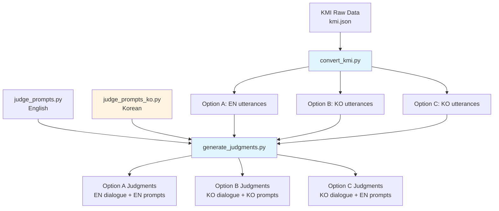
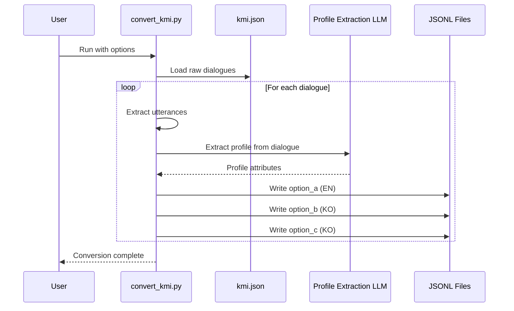
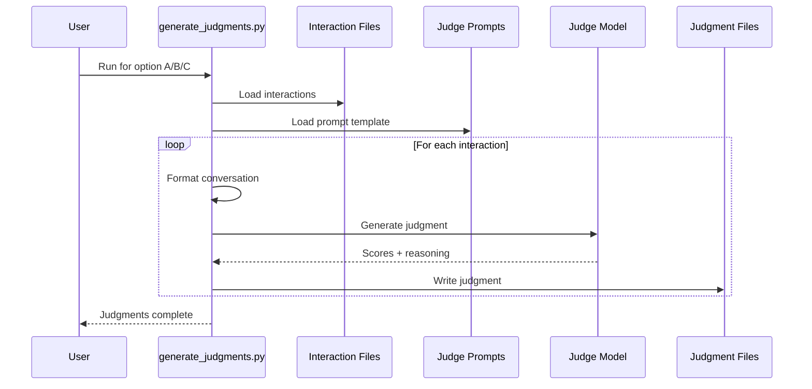

# Design Document: KMI Dataset Evaluation

## Overview

This feature adds support for the KMI (Korean Mental health Interview) dataset to the mind-eval evaluation framework. The KMI dataset contains 1000 Korean-English bilingual therapy dialogues with parallel translations. The implementation enables three distinct evaluation options that mirror the SimpsyDial workflow: (A) English utterances with English judgment prompts, (B) Korean utterances with Korean judgment prompts, and (C) Korean utterances with English judgment prompts. This cross-lingual evaluation capability allows researchers to assess how language choice in both dialogue content and evaluation criteria affects therapeutic quality judgments.

The feature consists of three main components: a conversion script that transforms KMI raw data into Mind-Eval format with profile extraction, a Korean judgment prompt module for native-language evaluation, and integration with existing judgment generation infrastructure. The design reuses the proven SimpsyDial architecture while accommodating KMI's unique bilingual structure and Korean cultural context.

## Correctness Properties

*A property is a characteristic or behavior that should hold true across all valid executions of a system—essentially, a formal statement about what the system should do. Properties serve as the bridge between human-readable specifications and machine-verifiable correctness guarantees.*

### Property 1: Field Extraction Completeness

*For any* KMI dialogue with valid turn structure, converting the dialogue SHALL extract both utterance_ko and utterance_en fields from every turn.

**Validates: Requirements 1.2**

### Property 2: Role Mapping Consistency

*For any* dialogue turn with role "Therapist" or "Client", the conversion SHALL map "Therapist" to "assistant" and "Client" to "user" consistently across all turns.

**Validates: Requirements 1.3**

### Property 3: Three-Variant Output Generation

*For any* valid KMI dialogue, the conversion process SHALL generate exactly three output variants (Option A, Option B, Option C).

**Validates: Requirements 1.4**

### Property 4: Language Selection Correctness

*For any* converted dialogue, Option A SHALL use utterance_en for all turns, while Option B and Option C SHALL use utterance_ko for all turns.

**Validates: Requirements 1.5, 1.6, 1.7**

### Property 5: Dialogue Count Limiting

*For any* max_dialogues parameter value N and dataset with M dialogues, the conversion SHALL process at most min(N, M) dialogues.

**Validates: Requirements 2.1, 2.2**

### Property 6: Duplicate Dialogue Exclusion

*For any* dialogue ID that exists in existing output files when skip_existing is enabled, the conversion SHALL exclude that dialogue from processing.

**Validates: Requirements 2.3, 2.4**

### Property 7: Profile Extraction Input Language

*For any* dialogue when profile extraction is enabled, the extraction prompt SHALL use utterance_en fields as input content.

**Validates: Requirements 3.2**

### Property 8: Profile Merge Completeness

*For any* extracted profile attributes and default profile values, the merged profile SHALL contain all required Mind-Eval profile fields.

**Validates: Requirements 3.3**

### Property 9: Profile Extraction Fallback

*For any* dialogue when profile extraction is disabled or fails, the conversion SHALL use default Korean profile values.

**Validates: Requirements 3.4, 3.5**

### Property 10: Korean Profile Defaults

*For any* KMI dialogue, the default profile SHALL set race to "Asian" and region to "urban".

**Validates: Requirements 3.6, 13.2, 13.3**

### Property 11: Mind-Eval Format Structure

*For any* created interaction, the output SHALL include member_profile, interaction, and metadata fields, where member_profile contains all required attributes, interaction contains turns with role and content fields, and metadata contains source, original_id, category, language, option, and profile_extracted fields.

**Validates: Requirements 4.1, 4.2, 4.3, 4.4, 9.1, 9.2, 9.3, 9.4, 9.5**

### Property 12: Option Metadata Correctness

*For any* converted dialogue, Option A metadata SHALL have language="en" and option="a", Option B metadata SHALL have language="ko" and option="b", and Option C metadata SHALL have language="ko" and option="c".

**Validates: Requirements 4.5, 4.6, 4.7**

### Property 13: Template Variable Placeholder Consistency

*For any* variable placeholder in the English JUDGE_PROMPT_TEMPLATE, the same placeholder SHALL exist in the Korean JUDGE_PROMPT_TEMPLATE_KO.

**Validates: Requirements 5.6**

### Property 14: Incomplete Dialogue Handling

*For any* dialogue missing utterance_ko or utterance_en fields in any turn, the conversion SHALL skip that dialogue and log a warning.

**Validates: Requirements 7.2**

### Property 15: Invalid JSON Recovery

*For any* invalid JSON response from the LLM during profile extraction, the conversion SHALL use default profile values and continue processing.

**Validates: Requirements 7.5**

### Property 16: Incremental File Updates

*For any* existing output file and new conversion results, the final output SHALL combine existing conversions with new conversions.

**Validates: Requirements 8.1, 8.2**

### Property 17: Unknown Attribute Fallback

*For any* profile attribute that cannot be determined during extraction, the conversion SHALL use "Unknown" rather than making assumptions.

**Validates: Requirements 13.4**

## Architecture



## Sequence Diagrams

### Conversion Workflow



### Judgment Generation Workflow



## Components and Interfaces

### Component 1: KMI Data Converter

**Purpose**: Transform KMI raw JSON data into Mind-Eval format with three language options

**Interface**:
```python
def convert_kmi_dialogue(
    dialogue: Dict[str, Any],
    extract_profile: bool = True,
    profile_extraction_params: Optional[Dict[str, Any]] = None
) -> Tuple[Dict, Dict, Dict]:
    """
    Convert a single KMI dialogue to Mind-Eval format for all three options.
    
    Args:
        dialogue: KMI dialogue dict with id, category, and dialogue list
        extract_profile: Whether to extract profile from dialogue
        profile_extraction_params: API parameters for profile extraction model
        
    Returns:
        Tuple of (option_a_dict, option_b_dict, option_c_dict) in Mind-Eval format
    """
    pass

def main(
    input_path: str,
    output_dir: str,
    max_dialogues: Optional[int] = None,
    extract_profile: bool = True,
    profile_extraction_params: Optional[Dict[str, Any]] = None,
    skip_existing: bool = True
) -> None:
    """
    Convert all KMI dialogues to Mind-Eval format.
    
    Args:
        input_path: Path to kmi.json
        output_dir: Directory for output files (data/KMI/test/)
        max_dialogues: Maximum number of dialogues to process
        extract_profile: Whether to extract profiles
        profile_extraction_params: API parameters for extraction
        skip_existing: Skip already converted dialogues
    """
    pass
```

**Responsibilities**:
- Load KMI raw JSON data
- Extract English and Korean utterances for each dialogue turn
- Generate three output variants (option A, B, C)
- Extract client profiles from dialogue content using LLM
- Handle Korean cultural context in profile extraction
- Write output to separate JSONL files per option

### Component 2: Korean Judgment Prompts

**Purpose**: Provide Korean-language judgment prompts for native evaluation

**Interface**:
```python
from string import Template

JUDGE_PROMPT_TEMPLATE_KO: Template
"""
Korean translation of the judge prompt template.
Contains:
- Evaluation framework in Korean
- Five criteria descriptions in Korean
- Rating scale (1-6) with Korean explanations
- Output format instructions in Korean
"""

# Example structure (user will provide actual Korean translation)
JUDGE_PROMPT_TEMPLATE_KO = Template("""
당신은 AI 치료사와 정신 건강 프로그램 회원 간의 대화를 평가하는 전문 평가자입니다...

<평가_기준>
1. 임상적 정확성 및 역량
2. 윤리적 및 전문적 행동
3. 평가 및 반응
4. 치료적 관계 및 동맹
5. AI 특정 의사소통 품질
</평가_기준>

<회원_정보>
- 이름: $name
- 성별: $sex
...
</회원_정보>

<대화>
$conversation_str
</대화>
""")
```

**Responsibilities**:
- Provide culturally appropriate Korean evaluation criteria
- Maintain semantic equivalence with English prompts
- Support Korean-specific therapeutic concepts
- Format output in consistent structure

### Component 3: Profile Extraction for Korean Context

**Purpose**: Extract client profiles from Korean therapy dialogues with cultural awareness

**Interface**:
```python
def extract_profile_from_korean_dialogue(
    dialogue: List[Dict[str, str]],
    model_api_params: Dict[str, Any]
) -> Dict[str, Any]:
    """
    Extract member profile from Korean counseling dialogue using LLM.
    
    Uses English utterances (utterance_en) for extraction to leverage
    existing English extraction prompt, but considers Korean cultural context.
    
    Args:
        dialogue: List of turns with role, utterance_ko, utterance_en
        model_api_params: API parameters for extraction model
        
    Returns:
        Dict with extracted profile attributes
    """
    pass
```

**Responsibilities**:
- Extract profiles from bilingual dialogue content
- Handle Korean cultural concepts (e.g., family dynamics, social pressure)
- Map Korean context to Mind-Eval profile schema
- Provide defaults for unknown attributes

## Data Models

### KMI Raw Dialogue Model

```python
from typing import List, Dict, Optional

class KMIUtterance:
    """Single utterance in KMI dialogue"""
    role: str  # "Therapist" or "Client"
    utterance_ko: str  # Korean text
    utterance_en: str  # English translation
    label: Optional[str]  # Therapist technique label (e.g., "Open Question")

class KMIDialogue:
    """Complete KMI dialogue"""
    id: int  # Dialogue ID (1-1000)
    category_ko: str  # Korean category (e.g., "정신건강")
    category_en: str  # English category (e.g., "Mental Health")
    dialogue: List[KMIUtterance]  # List of utterances
```

**Validation Rules**:
- id must be unique integer
- dialogue must contain at least 2 turns
- Each turn must have both utterance_ko and utterance_en
- role must be "Therapist" or "Client"
- label only present for Therapist turns

### Mind-Eval Format Model

```python
class MindEvalInteraction:
    """Mind-Eval format interaction"""
    member_profile: Dict[str, Any]  # Profile attributes
    interaction: List[Dict[str, str]]  # List of {role, content} turns
    metadata: Dict[str, Any]  # Source, language, options info

# Example structure
{
    "member_profile": {
        "name": "Anonymous",
        "sex": "Unknown",
        "age": 30,
        "race": "Asian",
        # ... other attributes
    },
    "interaction": [
        {"role": "assistant", "content": "안녕하세요..."},  # Therapist
        {"role": "user", "content": "다른 사람들이..."}  # Client
    ],
    "metadata": {
        "source": "KMI",
        "original_id": 1,
        "category": "Mental Health",
        "language": "ko",  # or "en"
        "option": "b",  # "a", "b", or "c"
        "profile_extracted": True
    }
}
```

**Validation Rules**:
- member_profile must contain all required Mind-Eval fields
- interaction must alternate between roles
- metadata must specify source, language, and option
- role must be "user" (client) or "assistant" (therapist)

### Judgment Output Model

```python
class Judgment:
    """Judgment output structure"""
    parsed_judgment: Dict[str, float]  # Criterion scores
    unparsed_judgment: str  # Raw LLM output
    thinking_trace: str  # LLM reasoning process

# Example structure
{
    "parsed_judgment": {
        "clinical_accuracy": 3.75,
        "ethical_conduct": 4.5,
        "assessment_response": 3.25,
        "therapeutic_alliance": 2.75,
        "communication_quality": 2.5
    },
    "unparsed_judgment": "<think>...</think>\n\nClinical Accuracy: 3.75\n...",
    "thinking_trace": "..."
}
```

## Algorithmic Pseudocode

### Main Conversion Algorithm

```python
def convert_kmi_dataset(input_path, output_dir, max_dialogues, extract_profile, profile_params):
    """
    INPUT: input_path (path to kmi.json), output_dir, max_dialogues, extract_profile, profile_params
    OUTPUT: Three JSONL files (option_a, option_b, option_c)
    
    PRECONDITIONS:
    - input_path points to valid kmi.json file
    - output_dir exists or can be created
    - profile_params contains valid API configuration if extract_profile is True
    
    POSTCONDITIONS:
    - Three JSONL files created in output_dir
    - Each file contains max_dialogues (or all) converted dialogues
    - All dialogues have valid Mind-Eval format
    """
    
    # Load existing conversions if skip_existing
    existing_a = load_existing_jsonl(output_dir / "option_a_interactions_en.jsonl")
    existing_b = load_existing_jsonl(output_dir / "option_b_interactions_ko.jsonl")
    existing_c = load_existing_jsonl(output_dir / "option_c_interactions_ko.jsonl")
    
    # Load KMI raw data
    with open(input_path) as f:
        kmi_data = json.load(f)
    
    # Apply max_dialogues limit
    if max_dialogues:
        kmi_data = kmi_data[:max_dialogues]
    
    # Filter out already converted
    processed_ids = {item["metadata"]["original_id"] for item in existing_a}
    kmi_data = [d for d in kmi_data if d["id"] not in processed_ids]
    
    option_a_results = []
    option_b_results = []
    option_c_results = []
    
    # Process each dialogue
    for dialogue in tqdm(kmi_data):
        # Extract profile (using English utterances)
        if extract_profile:
            profile = extract_profile_from_korean_dialogue(dialogue, profile_params)
        else:
            profile = get_default_korean_profile()
        
        # Create option A: English utterances
        option_a = create_interaction(
            dialogue=dialogue,
            profile=profile,
            use_korean=False,
            option="a"
        )
        option_a_results.append(option_a)
        
        # Create option B: Korean utterances
        option_b = create_interaction(
            dialogue=dialogue,
            profile=profile,
            use_korean=True,
            option="b"
        )
        option_b_results.append(option_b)
        
        # Create option C: Korean utterances (same as B, different judgment prompts)
        option_c = create_interaction(
            dialogue=dialogue,
            profile=profile,
            use_korean=True,
            option="c"
        )
        option_c_results.append(option_c)
    
    # Combine with existing and save
    save_jsonl(existing_a + option_a_results, output_dir / "option_a_interactions_en.jsonl")
    save_jsonl(existing_b + option_b_results, output_dir / "option_b_interactions_ko.jsonl")
    save_jsonl(existing_c + option_c_results, output_dir / "option_c_interactions_ko.jsonl")
```

### Profile Extraction Algorithm

```python
def extract_profile_from_korean_dialogue(dialogue, model_api_params):
    """
    INPUT: dialogue (KMI dialogue dict), model_api_params (API config)
    OUTPUT: profile (dict with member attributes)
    
    PRECONDITIONS:
    - dialogue contains valid utterance_en fields
    - model_api_params contains valid API configuration
    
    POSTCONDITIONS:
    - Returns dict with all Mind-Eval profile fields
    - Unknown fields set to "Unknown"
    - Korean cultural context considered in extraction
    """
    
    # Format client turns only (English version for LLM)
    client_turns = []
    for i, turn in enumerate(dialogue["dialogue"]):
        if turn["role"] == "Client":
            client_turns.append(f"[Client Turn {i+1}]\n{turn['utterance_en']}")
    
    dialogue_text = "\n\n".join(client_turns)
    
    # Build extraction prompt (reuse SimpsyDial prompt with Korean context notes)
    prompt = build_profile_extraction_prompt(dialogue_text, korean_context=True)
    
    # Call LLM
    model = InferenceEngine(model_api_params)
    response = model.generate([{"role": "user", "content": prompt}])
    
    # Parse JSON response
    try:
        extracted = parse_json_response(response)
        # Merge with defaults
        profile = DEFAULT_KOREAN_PROFILE.copy()
        profile.update(extracted)
        return profile
    except Exception as e:
        print(f"Profile extraction failed: {e}")
        return DEFAULT_KOREAN_PROFILE.copy()
```

### Interaction Creation Algorithm

```python
def create_interaction(dialogue, profile, use_korean, option):
    """
    INPUT: dialogue (KMI dict), profile (dict), use_korean (bool), option (str)
    OUTPUT: Mind-Eval format dict
    
    PRECONDITIONS:
    - dialogue contains valid utterance_ko and utterance_en fields
    - profile contains all required Mind-Eval fields
    - option is "a", "b", or "c"
    
    POSTCONDITIONS:
    - Returns valid Mind-Eval format dict
    - interaction uses correct language based on use_korean
    - metadata correctly identifies option and language
    
    LOOP INVARIANTS:
    - All processed turns maintain role consistency
    - Language selection remains consistent throughout dialogue
    """
    
    interaction = []
    
    # Process each turn
    for turn in dialogue["dialogue"]:
        # Map role: Therapist -> assistant, Client -> user
        role = "assistant" if turn["role"] == "Therapist" else "user"
        
        # Select language
        content = turn["utterance_ko"] if use_korean else turn["utterance_en"]
        
        interaction.append({"role": role, "content": content})
    
    # Build Mind-Eval format
    return {
        "member_profile": profile,
        "interaction": interaction,
        "metadata": {
            "source": "KMI",
            "original_id": dialogue["id"],
            "category": dialogue["category_en"],
            "language": "ko" if use_korean else "en",
            "option": option,
            "profile_extracted": True
        }
    }
```

## Key Functions with Formal Specifications

### Function 1: convert_kmi_dialogue()

```python
def convert_kmi_dialogue(
    dialogue: Dict[str, Any],
    extract_profile: bool = True,
    profile_extraction_params: Optional[Dict[str, Any]] = None
) -> Tuple[Dict, Dict, Dict]:
    """Convert single KMI dialogue to three Mind-Eval format variants"""
    pass
```

**Preconditions:**
- `dialogue` is non-null and contains required fields: id, category_ko, category_en, dialogue
- `dialogue["dialogue"]` is a non-empty list
- Each turn in dialogue has role, utterance_ko, utterance_en fields
- If `extract_profile` is True, `profile_extraction_params` must be valid API config

**Postconditions:**
- Returns tuple of three dicts (option_a, option_b, option_c)
- Each dict is valid Mind-Eval format
- option_a uses English utterances (utterance_en)
- option_b and option_c use Korean utterances (utterance_ko)
- All three share the same extracted profile
- metadata correctly identifies language and option

**Loop Invariants:** N/A (no loops in function body)

### Function 2: extract_profile_from_korean_dialogue()

```python
def extract_profile_from_korean_dialogue(
    dialogue: List[Dict[str, str]],
    model_api_params: Dict[str, Any]
) -> Dict[str, Any]:
    """Extract profile from Korean dialogue using LLM"""
    pass
```

**Preconditions:**
- `dialogue` is non-empty list of turn dicts
- Each turn has "role" and "utterance_en" fields
- `model_api_params` contains valid API configuration

**Postconditions:**
- Returns dict with all Mind-Eval profile fields
- All fields have valid values or "Unknown"
- Korean cultural context considered in extraction
- No exceptions raised (returns default profile on error)

**Loop Invariants:**
- For client turn extraction loop: All previously processed turns are valid client turns

### Function 3: create_interaction()

```python
def create_interaction(
    dialogue: Dict[str, Any],
    profile: Dict[str, Any],
    use_korean: bool,
    option: str
) -> Dict[str, Any]:
    """Create Mind-Eval format interaction from KMI dialogue"""
    pass
```

**Preconditions:**
- `dialogue` contains valid KMI structure
- `profile` contains all required Mind-Eval fields
- `option` is one of "a", "b", "c"
- All turns have both utterance_ko and utterance_en

**Postconditions:**
- Returns valid Mind-Eval format dict
- interaction list uses correct language based on `use_korean`
- Roles correctly mapped (Therapist->assistant, Client->user)
- metadata accurately reflects language and option

**Loop Invariants:**
- All processed turns maintain correct role mapping
- Language selection consistent for all turns

## Example Usage

### Converting KMI Dataset

```python
# Basic conversion with profile extraction
python mindeval/scripts/convert_kmi.py \
    --input_path data/KMI/raw/kmi.json \
    --output_dir data/KMI/test \
    --extract_profile \
    --profile_extraction_params '{"model":"gpt-4","api_key":"YOUR_KEY"}' \
    --max_dialogues 100

# Without profile extraction (use defaults)
python mindeval/scripts/convert_kmi.py \
    --input_path data/KMI/raw/kmi.json \
    --output_dir data/KMI/test \
    --max_dialogues 1000
```

### Generating Judgments for Each Option

```python
# Option A: English dialogue + English prompts
python mindeval/scripts/generate_judgments.py \
    --interactions_path data/KMI/test/option_a_interactions_en.jsonl \
    --judge_model_api_params '{"model":"gpt-4","api_key":"YOUR_KEY"}' \
    --judge_template_version "v0_1" \
    --output_path data/KMI/test/option_a_judgments.jsonl \
    --max_workers 5

# Option B: Korean dialogue + Korean prompts
python mindeval/scripts/generate_judgments.py \
    --interactions_path data/KMI/test/option_b_interactions_ko.jsonl \
    --judge_model_api_params '{"model":"gpt-4","api_key":"YOUR_KEY"}' \
    --judge_template_path "mindeval/judge_prompts_ko.py" \
    --output_path data/KMI/test/option_b_judgments.jsonl \
    --max_workers 5

# Option C: Korean dialogue + English prompts
python mindeval/scripts/generate_judgments.py \
    --interactions_path data/KMI/test/option_c_interactions_ko.jsonl \
    --judge_model_api_params '{"model":"gpt-4","api_key":"YOUR_KEY"}' \
    --judge_template_version "v0_1" \
    --output_path data/KMI/test/option_c_judgments.jsonl \
    --max_workers 5
```

### Programmatic Usage

```python
from mindeval.scripts.convert_kmi import convert_kmi_dialogue, main
from mindeval.utils import load_jsonl

# Convert single dialogue
with open("data/KMI/raw/kmi.json") as f:
    kmi_data = json.load(f)

dialogue = kmi_data[0]
option_a, option_b, option_c = convert_kmi_dialogue(
    dialogue=dialogue,
    extract_profile=True,
    profile_extraction_params={"model": "gpt-4", "api_key": "YOUR_KEY"}
)

print(f"Option A language: {option_a['metadata']['language']}")  # "en"
print(f"Option B language: {option_b['metadata']['language']}")  # "ko"
print(f"Option C language: {option_c['metadata']['language']}")  # "ko"

# Convert entire dataset
main(
    input_path="data/KMI/raw/kmi.json",
    output_dir="data/KMI/test",
    max_dialogues=100,
    extract_profile=True,
    profile_extraction_params={"model": "gpt-4", "api_key": "YOUR_KEY"},
    skip_existing=True
)
```

## Error Handling

### Error Scenario 1: Invalid KMI Data Format

**Condition**: KMI JSON file is malformed or missing required fields
**Response**: Raise ValueError with descriptive message indicating which field is missing
**Recovery**: User must fix the input file format

### Error Scenario 2: Profile Extraction Failure

**Condition**: LLM fails to extract profile or returns invalid JSON
**Response**: Log warning with error details, return default Korean profile
**Recovery**: Conversion continues with default profile values

### Error Scenario 3: Missing Korean Judgment Prompts

**Condition**: User attempts Option B judgment generation without judge_prompts_ko.py
**Response**: Raise FileNotFoundError with instructions to create Korean prompts
**Recovery**: User must provide Korean translation of judgment prompts

### Error Scenario 4: API Rate Limiting

**Condition**: LLM API returns rate limit error during batch processing
**Response**: Implement exponential backoff retry logic (3 attempts)
**Recovery**: If retries exhausted, save progress and exit with error message

### Error Scenario 5: Incomplete Dialogue Data

**Condition**: KMI dialogue missing utterance_ko or utterance_en for some turns
**Response**: Skip the dialogue and log warning with dialogue ID
**Recovery**: Continue processing remaining dialogues

## Testing Strategy

### Unit Testing Approach

**Test Coverage Goals**: 80%+ code coverage for core conversion logic

**Key Test Cases**:

1. **Data Loading Tests**
   - Test loading valid kmi.json
   - Test handling malformed JSON
   - Test handling missing fields

2. **Conversion Logic Tests**
   - Test role mapping (Therapist->assistant, Client->user)
   - Test language selection (Korean vs English)
   - Test metadata generation for each option
   - Test profile merging with defaults

3. **Profile Extraction Tests**
   - Test extraction with valid LLM response
   - Test handling of invalid JSON from LLM
   - Test default profile fallback
   - Test Korean cultural context handling

4. **File I/O Tests**
   - Test JSONL writing for each option
   - Test skip_existing logic
   - Test max_dialogues limiting

### Property-Based Testing Approach

Property-based testing is appropriate for this feature because the conversion logic involves pure transformations with clear invariants that should hold across all inputs.

**Property Test Library**: hypothesis (Python)

### Integration Testing Approach

**Integration Test Scenarios**:

1. **End-to-End Conversion**
   - Run conversion on sample KMI data (10 dialogues)
   - Verify three output files created
   - Verify file contents match expected format
   - Verify profile extraction called correctly

2. **Judgment Generation Integration**
   - Generate judgments for each option using test data
   - Verify Korean prompts loaded correctly for Option B
   - Verify English prompts used for Options A and C
   - Verify judgment output format

3. **Cross-Language Consistency**
   - Verify same dialogue ID produces consistent profiles across options
   - Verify interaction structure identical except for language
   - Verify metadata correctly distinguishes options

## Performance Considerations

**Profile Extraction Performance**:
- Profile extraction requires 1 LLM call per dialogue
- For 1000 dialogues: ~1000 API calls
- Estimated time: 10-30 minutes depending on API latency
- Mitigation: Implement skip_existing to resume interrupted runs

**Batch Processing**:
- Judgment generation uses batch processing (max_workers parameter)
- Recommended max_workers: 5-10 for API rate limit compliance
- Progress tracking with tqdm for long-running operations

**Memory Usage**:
- Load entire kmi.json into memory (~5-10 MB for 1000 dialogues)
- Process dialogues sequentially to minimize memory footprint
- Write results incrementally to JSONL files

**Caching Strategy**:
- Skip already converted dialogues (skip_existing=True)
- Skip already judged interactions (skip_existing=True in generate_judgments)
- Store intermediate results to enable resumption

## Security Considerations

**API Key Management**:
- API keys passed via command-line parameters (not hardcoded)
- Recommend using environment variables or config files
- Never commit API keys to version control

**Input Validation**:
- Validate KMI JSON structure before processing
- Sanitize dialogue content before LLM calls
- Validate LLM responses before parsing

**Data Privacy**:
- KMI dataset contains therapy dialogues (sensitive content)
- Ensure compliance with data usage agreements
- Do not log full dialogue content in error messages

## Dependencies

**Python Packages**:
- `jsonargparse`: Command-line argument parsing
- `tqdm`: Progress bars for long-running operations
- `typing`: Type hints for better code clarity
- Existing mind-eval modules:
  - `mindeval.utils`: JSONL I/O, conversation formatting
  - `mindeval.inference`: LLM API wrapper
  - `mindeval.judge_prompts`: English judgment prompts

**External Services**:
- OpenAI API (or compatible): For profile extraction and judgment generation
- Requires valid API key with sufficient quota

**Data Files**:
- `data/KMI/raw/kmi.json`: Source data (1000 dialogues)
- `mindeval/judge_prompts_ko.py`: Korean judgment prompts (user-provided)

**New Files to Create**:
- `mindeval/scripts/convert_kmi.py`: Main conversion script
- `mindeval/judge_prompts_ko.py`: Korean judgment prompt template
- `data/KMI/test/`: Output directory for converted files
