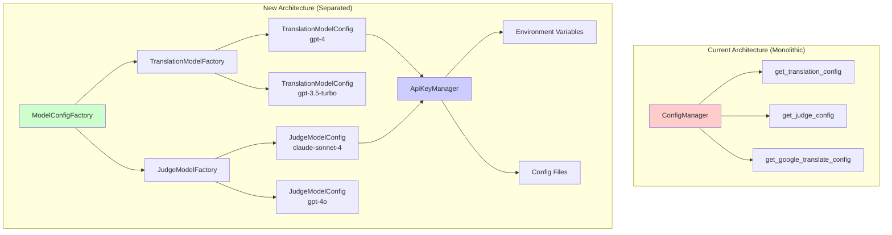
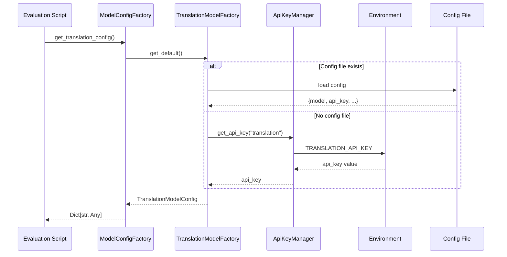
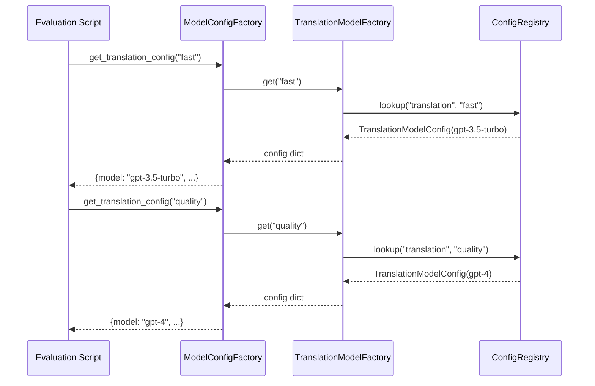

# Design Document: Separate Model Configuration

## Overview

This feature introduces a cleaner, more modular configuration system that separates translation model configuration from judge model configuration. The current `ConfigManager` class mixes all model configurations (translation, judge, google_translate) in a single class with shared logic. The new design introduces dedicated configuration classes for each model type, enabling better separation of concerns, support for multiple models per purpose, and clearer API key management.

The design maintains backward compatibility with existing code while providing a more flexible architecture for future enhancements like multi-model support and configuration validation.

## Architecture



### Key Architectural Changes

1. **Dedicated Config Classes**: Each model type has its own dataclass with type-specific fields
2. **Factory Pattern**: Factories create and cache config instances, supporting named configurations
3. **API Key Management**: Centralized key management with environment variable fallback
4. **Backward Compatibility**: Existing `get_translation_config()` and `get_judge_config()` functions preserved

## Sequence Diagrams

### Configuration Loading Flow



### Multi-Model Configuration Access



## Components and Interfaces

### Component 1: ModelConfig (Base Class)

**Purpose**: Base dataclass for all model configurations with common fields.

**Interface**:
```python
@dataclass
class ModelConfig:
    """Base configuration for any LLM model."""
    model: str
    api_key: str
    api_base: Optional[str] = None
    temperature: float = 0.3
    max_tokens: Optional[int] = None
    timeout: int = 60
    max_retries: int = 3
    
    def to_dict(self) -> Dict[str, Any]:
        """Convert to dictionary for InferenceEngine compatibility."""
        ...
    
    def validate(self) -> List[str]:
        """Validate configuration, return list of errors."""
        ...
```

**Responsibilities**:
- Define common configuration fields
- Provide serialization to dict for backward compatibility
- Basic validation (non-empty model, valid temperature range)

### Component 2: TranslationModelConfig

**Purpose**: Configuration specific to translation models with translation-specific defaults.

**Interface**:
```python
@dataclass
class TranslationModelConfig(ModelConfig):
    """Configuration for translation models (GPT-4, etc.)."""
    model: str = "gpt-4"
    temperature: float = 0.3  # Lower for consistent translations
    max_tokens: int = 4000
    
    def validate(self) -> List[str]:
        """Validate translation-specific requirements."""
        ...
```

**Responsibilities**:
- Translation-specific defaults (temperature 0.3 for consistency)
- Validation for translation models
- Higher max_tokens for dialogue translation

### Component 3: JudgeModelConfig

**Purpose**: Configuration specific to judge/evaluator models with evaluation-specific defaults.

**Interface**:
```python
@dataclass
class JudgeModelConfig(ModelConfig):
    """Configuration for judge/evaluator models."""
    model: str = "claude-sonnet-4"
    temperature: float = 0.3  # Lower for consistent judgments
    max_tokens: int = 4000
    
    def validate(self) -> List[str]:
        """Validate judge-specific requirements."""
        ...
```

**Responsibilities**:
- Judge-specific defaults
- Validation for judge models
- Support for thinking/reasoning models

### Component 4: ApiKeyManager

**Purpose**: Centralized API key management with secure handling and fallback logic.

**Interface**:
```python
class ApiKeyManager:
    """Manages API keys for different model providers."""
    
    _instance: Optional['ApiKeyManager'] = None
    
    @classmethod
    def get_instance(cls) -> 'ApiKeyManager':
        """Get singleton instance."""
        ...
    
    def get_api_key(
        self, 
        model_type: str,  # "translation" | "judge"
        provider: Optional[str] = None
    ) -> str:
        """Get API key with fallback logic."""
        ...
    
    def set_api_key(
        self, 
        model_type: str, 
        api_key: str,
        provider: Optional[str] = None
    ) -> None:
        """Set API key programmatically."""
        ...
```

**Responsibilities**:
- Single source of truth for API keys
- Environment variable fallback
- Secure key handling (never log keys)
- Support multiple providers (OpenAI, Anthropic, etc.)

### Component 5: ModelConfigFactory

**Purpose**: Factory for creating and retrieving model configurations.

**Interface**:
```python
class ModelConfigFactory:
    """Factory for creating model configurations."""
    
    def __init__(self, config_path: Optional[str] = None):
        """Initialize with optional config file path."""
        ...
    
    def get_translation_config(
        self, 
        name: str = "default"
    ) -> Dict[str, Any]:
        """Get translation model config by name."""
        ...
    
    def get_judge_config(
        self, 
        name: str = "default"
    ) -> Dict[str, Any]:
        """Get judge model config by name."""
        ...
    
    def register_translation_config(
        self, 
        name: str, 
        config: TranslationModelConfig
    ) -> None:
        """Register a named translation config."""
        ...
    
    def register_judge_config(
        self, 
        name: str, 
        config: JudgeModelConfig
    ) -> None:
        """Register a named judge config."""
        ...
```

**Responsibilities**:
- Create and cache config instances
- Support named configurations for multi-model scenarios
- Load from config file or environment variables
- Validate configurations on creation

### Component 6: ConfigRegistry

**Purpose**: Global registry for named configurations.

**Interface**:
```python
class ConfigRegistry:
    """Global registry for model configurations."""
    
    _translation_configs: Dict[str, TranslationModelConfig] = {}
    _judge_configs: Dict[str, JudgeModelConfig] = {}
    
    @classmethod
    def register_translation(cls, name: str, config: TranslationModelConfig) -> None:
        ...
    
    @classmethod
    def register_judge(cls, name: str, config: JudgeModelConfig) -> None:
        ...
    
    @classmethod
    def get_translation(cls, name: str) -> Optional[TranslationModelConfig]:
        ...
    
    @classmethod
    def get_judge(cls, name: str) -> Optional[JudgeModelConfig]:
        ...
    
    @classmethod
    def clear(cls) -> None:
        """Clear all registered configs (for testing)."""
        ...
```

**Responsibilities**:
- Store named configurations
- Thread-safe access
- Support for runtime configuration changes

## Data Models

### Translation Model Config JSON Schema

```json
{
  "translation_models": {
    "default": {
      "model": "gpt-4",
      "api_key": "${TRANSLATION_API_KEY}",
      "api_base": "https://api.openai.com/v1",
      "temperature": 0.3,
      "max_tokens": 4000,
      "timeout": 60,
      "max_retries": 3
    },
    "fast": {
      "model": "gpt-3.5-turbo",
      "api_key": "${TRANSLATION_API_KEY}",
      "api_base": "https://api.openai.com/v1",
      "temperature": 0.3,
      "max_tokens": 4000
    },
    "quality": {
      "model": "gpt-4-turbo",
      "api_key": "${TRANSLATION_API_KEY}",
      "api_base": "https://api.openai.com/v1",
      "temperature": 0.2,
      "max_tokens": 8000
    }
  }
}
```

**Validation Rules**:
- `model` must be non-empty string
- `api_key` must be non-empty (validated at runtime)
- `temperature` must be between 0.0 and 2.0
- `max_tokens` must be positive integer if provided
- `timeout` must be positive integer
- `max_retries` must be non-negative integer

### Judge Model Config JSON Schema

```json
{
  "judge_models": {
    "default": {
      "model": "claude-sonnet-4",
      "api_key": "${JUDGE_API_KEY}",
      "api_base": "https://api.anthropic.com",
      "temperature": 0.3,
      "max_tokens": 4000,
      "timeout": 60,
      "max_retries": 3
    },
    "gpt4": {
      "model": "gpt-4o",
      "api_key": "${OPENAI_API_KEY}",
      "api_base": "https://api.openai.com/v1",
      "temperature": 0.3,
      "max_tokens": 4000
    },
    "fast": {
      "model": "claude-3-haiku",
      "api_key": "${JUDGE_API_KEY}",
      "api_base": "https://api.anthropic.com",
      "temperature": 0.3,
      "max_tokens": 2000
    }
  }
}
```

**Validation Rules**:
- `model` must be non-empty string
- `api_key` must be non-empty (validated at runtime)
- `temperature` must be between 0.0 and 2.0
- `max_tokens` must be positive integer if provided

### New Config File Structure

```json
{
  "translation_models": {
    "default": { ... },
    "fast": { ... },
    "quality": { ... }
  },
  "judge_models": {
    "default": { ... },
    "gpt4": { ... },
    "fast": { ... }
  },
  "google_translate": {
    "credentials_path": "/path/to/credentials.json",
    "project_id": "your-google-cloud-project",
    "location": "global"
  }
}
```

## Key Functions with Formal Specifications

### Function 1: get_translation_config()

```python
def get_translation_config(
    config_path: Optional[str] = None,
    name: str = "default"
) -> Dict[str, Any]:
    """
    Get translation model configuration.
    
    Args:
        config_path: Path to config file (optional)
        name: Named configuration to retrieve
        
    Returns:
        Dictionary with model configuration suitable for InferenceEngine
    """
```

**Preconditions:**
- `name` is a non-empty string
- `config_path` is None or a valid file path (if provided)

**Postconditions:**
- Returns a valid dictionary with all required keys: `model`, `api_key`, `temperature`, `timeout`, `max_retries`
- If `api_key` is missing in both config file and environment, returns empty string for `api_key`
- Returned dictionary is compatible with `InferenceEngine` constructor
- Function is idempotent: calling multiple times returns same result

**Loop Invariants:** N/A

### Function 2: get_judge_config()

```python
def get_judge_config(
    config_path: Optional[str] = None,
    name: str = "default"
) -> Dict[str, Any]:
    """
    Get judge model configuration.
    
    Args:
        config_path: Path to config file (optional)
        name: Named configuration to retrieve
        
    Returns:
        Dictionary with model configuration suitable for InferenceEngine
    """
```

**Preconditions:**
- `name` is a non-empty string
- `config_path` is None or a valid file path (if provided)

**Postconditions:**
- Returns a valid dictionary with all required keys: `model`, `api_key`, `temperature`, `timeout`, `max_retries`
- If `api_key` is missing in both config file and environment, returns empty string for `api_key`
- Returned dictionary is compatible with `InferenceEngine` constructor

**Loop Invariants:** N/A

### Function 3: validate_config()

```python
def validate_config(
    config_path: Optional[str] = None
) -> Dict[str, List[str]]:
    """
    Validate model configurations.
    
    Args:
        config_path: Path to config file (optional)
        
    Returns:
        Dictionary mapping config type to list of error messages.
        Empty lists indicate valid configuration.
    """
```

**Preconditions:**
- `config_path` is None or a valid file path (if provided)

**Postconditions:**
- Returns dictionary with keys: `"translation"`, `"judge"`
- Each value is a list of error messages (empty if valid)
- Does not raise exceptions for invalid configs
- All error messages are human-readable strings

**Loop Invariants:** N/A

## Algorithmic Pseudocode

### Configuration Loading Algorithm

```pascal
ALGORITHM load_model_config
INPUT: 
    config_type: String  // "translation" | "judge"
    config_name: String  // default: "default"
    config_path: Optional<String>
OUTPUT: config_dict: Dict<String, Any>

BEGIN
    // Step 1: Initialize config source priority
    config_sources ← []
    
    // Step 2: Check config file (highest priority)
    IF config_path IS NOT NULL AND file_exists(config_path) THEN
        file_config ← parse_json_file(config_path)
        model_key ← config_type + "_models"  // "translation_models" | "judge_models"
        
        IF file_config[model_key] EXISTS THEN
            IF file_config[model_key][config_name] EXISTS THEN
                config_sources.append(file_config[model_key][config_name])
            ELSE IF config_name = "default" AND file_config[model_key] HAS ANY KEY THEN
                // Use first available as default
                first_key ← get_first_key(file_config[model_key])
                config_sources.append(file_config[model_key][first_key])
            END IF
        END IF
    END IF
    
    // Step 3: Check environment variables (fallback)
    env_prefix ← to_upper(config_type)  // "TRANSLATION" | "JUDGE"
    
    env_config ← {
        "model": get_env(env_prefix + "_MODEL"),
        "api_key": get_env(env_prefix + "_API_KEY"),
        "api_base": get_env(env_prefix + "_API_BASE")
    }
    
    IF env_config["model"] IS NOT NULL THEN
        config_sources.append(env_config)
    END IF
    
    // Step 4: Merge configurations (first source wins)
    IF length(config_sources) = 0 THEN
        config_dict ← get_default_config(config_type)
    ELSE
        config_dict ← merge_with_defaults(config_sources[0], config_type)
    END IF
    
    // Step 5: Validate required fields
    ASSERT config_dict["model"] IS NOT EMPTY
    
    RETURN config_dict
END
```

**Preconditions:**
- `config_type` is either "translation" or "judge"
- `config_name` is a non-empty string

**Postconditions:**
- Returns a valid configuration dictionary
- `model` field is always present and non-empty
- All fields have valid types
- Missing `api_key` results in empty string (not None)

**Loop Invariants:** N/A (no loops)

### Configuration Validation Algorithm

```pascal
ALGORITHM validate_model_config
INPUT: config: Dict<String, Any>
OUTPUT: errors: List<String>

BEGIN
    errors ← []
    
    // Validate model name
    IF config["model"] IS NULL OR config["model"] = "" THEN
        errors.append("Model name is required")
    END IF
    
    // Validate API key
    IF config["api_key"] IS NULL THEN
        errors.append("API key is required")
    END IF
    
    // Validate temperature range
    IF config["temperature"] < 0.0 OR config["temperature"] > 2.0 THEN
        errors.append("Temperature must be between 0.0 and 2.0")
    END IF
    
    // Validate max_tokens
    IF config["max_tokens"] IS NOT NULL AND config["max_tokens"] <= 0 THEN
        errors.append("max_tokens must be positive")
    END IF
    
    // Validate timeout
    IF config["timeout"] <= 0 THEN
        errors.append("timeout must be positive")
    END IF
    
    // Validate max_retries
    IF config["max_retries"] < 0 THEN
        errors.append("max_retries must be non-negative")
    END IF
    
    RETURN errors
END
```

**Preconditions:**
- `config` is a dictionary (may be incomplete)

**Postconditions:**
- Returns list of error messages (empty if valid)
- Does not raise exceptions
- All error messages are human-readable

**Loop Invariants:** N/A (no loops)

## Example Usage

### Basic Usage (Backward Compatible)

```python
from mindeval.config import get_translation_config, get_judge_config

# Get default translation config (same as before)
translation_config = get_translation_config()
# Returns: {"model": "gpt-4", "api_key": "...", ...}

# Get default judge config (same as before)
judge_config = get_judge_config()
# Returns: {"model": "claude-sonnet-4", "api_key": "...", ...}
```

### Multi-Model Usage

```python
from mindeval.config import ModelConfigFactory, TranslationModelConfig, JudgeModelConfig

# Create factory with config file
factory = ModelConfigFactory(config_path="config.json")

# Get different translation configs
fast_translation = factory.get_translation_config("fast")
# Returns: {"model": "gpt-3.5-turbo", "api_key": "...", ...}

quality_translation = factory.get_translation_config("quality")
# Returns: {"model": "gpt-4-turbo", "api_key": "...", ...}

# Get different judge configs
fast_judge = factory.get_judge_config("fast")
# Returns: {"model": "claude-3-haiku", "api_key": "...", ...}
```

### Programmatic Configuration

```python
from mindeval.config import (
    TranslationModelConfig,
    JudgeModelConfig,
    ModelConfigFactory
)

# Create custom configs programmatically
custom_translation = TranslationModelConfig(
    model="gpt-4-turbo",
    api_key="your-key",
    temperature=0.2,
    max_tokens=8000
)

custom_judge = JudgeModelConfig(
    model="gpt-4o",
    api_key="your-key",
    temperature=0.1
)

# Register with factory
factory = ModelConfigFactory()
factory.register_translation_config("custom", custom_translation)
factory.register_judge_config("custom", custom_judge)

# Use in scripts
config = factory.get_translation_config("custom")
```

### Integration with Existing Scripts

```python
# In run_three_way_evaluation.py
from mindeval.config import get_translation_config, get_judge_config

def run_option_a(dialogues_path, config_path, ...):
    # Same usage as before - backward compatible
    translation_config = get_translation_config(config_path)
    judge_config = get_judge_config(config_path)
    
    # Use with InferenceEngine
    from mindeval.inference import InferenceEngine
    model = InferenceEngine(translation_config)
```

## Correctness Properties

*A property is a characteristic or behavior that should hold true across all valid executions of a system-essentially, a formal statement about what the system should do. Properties serve as the bridge between human-readable specifications and machine-verifiable correctness guarantees.*

### Property 1: Configuration Serialization Round-Trip

*For any* valid TranslationModelConfig or JudgeModelConfig, serializing to a dictionary and deserializing back SHALL produce an equivalent configuration object.

**Validates: Requirements 2.5, 3.5**

### Property 2: Dictionary Contains All Fields

*For any* ModelConfig instance, the to_dict() method SHALL return a dictionary containing all configuration fields (model, api_key, api_base, temperature, max_tokens, timeout, max_retries).

**Validates: Requirements 1.2**

### Property 3: Invalid Temperature Detection

*For any* temperature value less than 0.0 or greater than 2.0, validate() SHALL return an error message indicating the temperature is out of range.

**Validates: Requirements 1.4**

### Property 4: Invalid max_tokens Detection

*For any* max_tokens value that is provided and is less than or equal to 0, validate() SHALL return an error message indicating max_tokens must be positive.

**Validates: Requirements 1.5**

### Property 5: Invalid timeout Detection

*For any* timeout value less than or equal to 0, validate() SHALL return an error message indicating timeout must be positive.

**Validates: Requirements 1.6**

### Property 6: Invalid max_retries Detection

*For any* max_retries value less than 0, validate() SHALL return an error message indicating max_retries must be non-negative.

**Validates: Requirements 1.7**

### Property 7: Config Registry Round-Trip

*For any* TranslationModelConfig or JudgeModelConfig, registering it with a name and then retrieving it SHALL return the same configuration.

**Validates: Requirements 5.6, 5.7, 6.1, 6.2, 6.3, 6.4**

### Property 8: Default Configuration Keys

*For any* call to get_translation_config() or get_judge_config() without arguments, the returned dictionary SHALL contain all required keys: model, api_key, api_base, temperature, max_tokens, timeout, max_retries.

**Validates: Requirements 7.1, 7.2**

### Property 9: Config File Parsing Round-Trip

*For any* valid configuration object, serializing to JSON, then parsing back SHALL produce an equivalent configuration.

**Validates: Requirements 8.4**

### Property 10: Valid Config Passes Validation

*For any* configuration with valid model, api_key, temperature in [0.0, 2.0], positive max_tokens (if provided), positive timeout, and non-negative max_retries, validate_config() SHALL return an empty error list.

**Validates: Requirements 10.2**

### Property 11: API Key Not Exposed in Summary

*For any* configuration with a non-empty API key, print_config_summary() output SHALL contain "✓ Set" or "✗ Missing" but SHALL NOT contain the actual API key value.

**Validates: Requirements 11.1**

### Property 12: API Key Not Exposed in Errors

*For any* configuration with a non-empty API key, when an error occurs during configuration processing, the error message SHALL NOT contain the API key value.

**Validates: Requirements 11.3**

### Property 13: Configuration Caching Identity

*For any* configuration loaded through ModelConfigFactory, requesting the same configuration multiple times SHALL return the same cached object (identical reference).

**Validates: Requirements 13.1, 13.2**

## Error Handling

### Error Scenario 1: Missing Config File

**Condition**: Specified config file does not exist
**Response**: Log warning, fall back to environment variables
**Recovery**: Continue with environment-based configuration
**Example**:
```python
# Config file missing, but env vars set
config = get_translation_config(config_path="missing.json")
# Logs: "Config file not found: missing.json, using environment variables"
# Returns config from TRANSLATION_MODEL, TRANSLATION_API_KEY env vars
```

### Error Scenario 2: Missing API Key

**Condition**: No API key in config file or environment variables
**Response**: Return config with empty api_key string
**Recovery**: Validation will flag this; InferenceEngine will fail with clear error
**Example**:
```python
config = get_translation_config()
# config["api_key"] = ""
# validate_config() returns {"translation": ["API key is required"]}
```

### Error Scenario 3: Invalid Config JSON

**Condition**: Config file contains invalid JSON
**Response**: Raise JSONDecodeError with file path
**Recovery**: User must fix JSON syntax
**Example**:
```python
try:
    factory = ModelConfigFactory(config_path="broken.json")
except json.JSONDecodeError as e:
    print(f"Invalid JSON in config file: {e}")
```

### Error Scenario 4: Unknown Named Configuration

**Condition**: Requested config name does not exist
**Response**: Fall back to default, log warning
**Recovery**: Use default configuration
**Example**:
```python
config = factory.get_translation_config("unknown")
# Logs: "Configuration 'unknown' not found, using 'default'"
# Returns default translation config
```

### Error Scenario 5: Invalid Temperature Value

**Condition**: Temperature outside valid range [0.0, 2.0]
**Response**: Validation returns error message
**Recovery**: Use default temperature or fix config
**Example**:
```python
errors = validate_config()
# errors = {"translation": ["Temperature must be between 0.0 and 2.0"]}
```

## Testing Strategy

### Unit Testing Approach

Test each component in isolation:
- `ModelConfig` base class serialization and validation
- `TranslationModelConfig` defaults and validation
- `JudgeModelConfig` defaults and validation
- `ApiKeyManager` key retrieval and fallback logic
- `ModelConfigFactory` config creation and caching

**Coverage Goals**: 90%+ for all new classes

### Property-Based Testing Approach

Use `hypothesis` library for property-based testing:

**Properties to test**:
1. **Serialization Round-trip**: Any valid config can be serialized to dict and back
2. **Merge Completeness**: Merging any partial config with defaults produces valid config
3. **Validation Consistency**: Validation results are consistent across multiple calls
4. **Environment Fallback**: Config correctly falls back to environment variables

**Example Property Test**:
```python
from hypothesis import given, strategies as st

@given(
    model=st.text(min_size=1, max_size=50),
    temperature=st.floats(min_value=0.0, max_value=2.0),
    max_tokens=st.integers(min_value=1, max_value=100000) | st.none()
)
def test_config_serialization_roundtrip(model, temperature, max_tokens):
    config = TranslationModelConfig(
        model=model,
        api_key="test-key",
        temperature=temperature,
        max_tokens=max_tokens
    )
    config_dict = config.to_dict()
    recreated = TranslationModelConfig.from_dict(config_dict)
    assert config == recreated
```

### Integration Testing Approach

Test with actual config files and environment variables:
1. Load from config file only
2. Load from environment variables only
3. Load with config file overriding environment
4. Test with multiple named configurations
5. Test backward compatibility with existing scripts

## Performance Considerations

1. **Configuration Caching**: Factory caches loaded configurations to avoid repeated file I/O
2. **Lazy Loading**: Configurations are loaded on first access, not at module import
3. **Singleton ApiKeyManager**: Single instance avoids duplicate environment variable lookups
4. **Minimal Overhead**: Configuration loading adds < 1ms overhead compared to current implementation

## Security Considerations

1. **API Key Protection**: 
   - API keys are never logged
   - API keys are masked in `print_config_summary()`
   - API keys are validated but not echoed back in error messages

2. **Config File Permissions**: 
   - Recommend `chmod 600` for config files containing API keys
   - Add warning if config file has overly permissive permissions

3. **Environment Variable Priority**:
   - Config file values take precedence over environment variables
   - This allows secure defaults in environment with per-project overrides

## Dependencies

- **Standard Library**: `dataclasses`, `json`, `os`, `pathlib`, `typing`
- **Existing Dependencies**: No new external dependencies required
- **Backward Compatibility**: All existing code continues to work without changes

## Migration Path

### Phase 1: Add New Classes (Non-Breaking)
1. Add `ModelConfig`, `TranslationModelConfig`, `JudgeModelConfig` dataclasses
2. Add `ApiKeyManager` class
3. Add `ModelConfigFactory` class
4. Keep existing `ConfigManager` and functions unchanged

### Phase 2: Update Functions (Non-Breaking)
1. Update `get_translation_config()` to use new factory internally
2. Update `get_judge_config()` to use new factory internally
3. Maintain identical return values and behavior

### Phase 3: Update Config File Format (Optional)
1. Support new config file format with `translation_models` and `judge_models`
2. Maintain backward compatibility with old format (`translation`, `judge`)
3. Add migration script for users with complex configurations

### Phase 4: Deprecation (Future)
1. Add deprecation warnings for direct `ConfigManager` usage
2. Recommend new factory-based approach
3. Update documentation with examples
