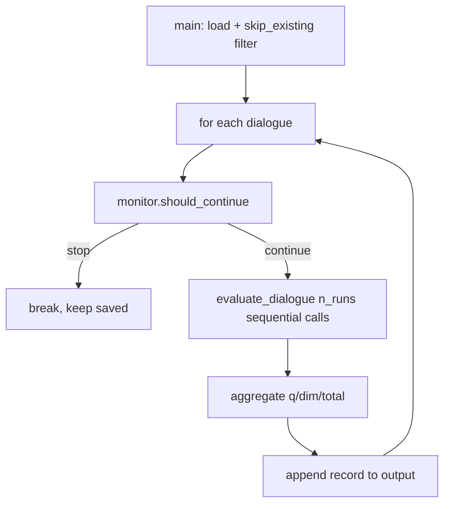
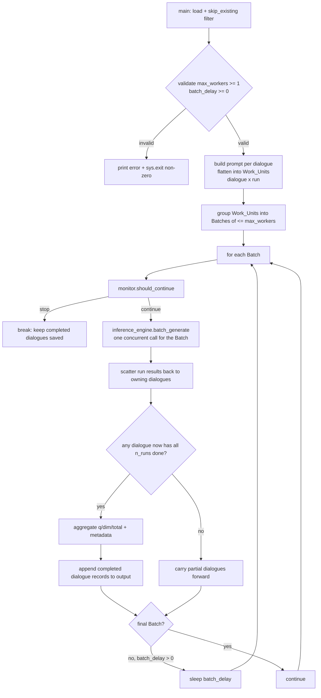
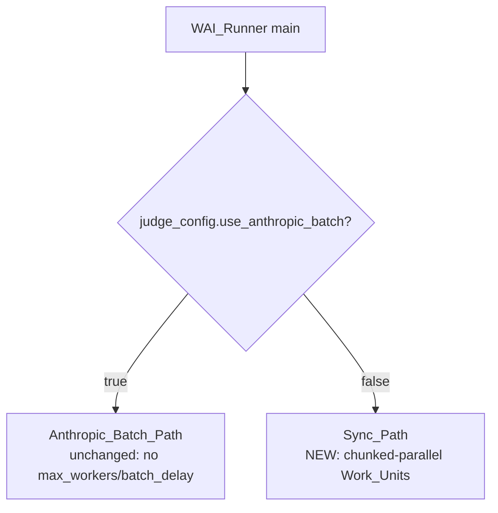

# Design Document

## Overview

This feature parallelizes the WAI (Working Alliance Inventory) Sync_Path and wires the
`--max_workers` / `--batch_delay` CLI flags through to the WAI_Runner, mirroring the
chunked-parallel pattern already implemented in the Mind-Eval Reference_Runner
(`mindeval/scripts/generate_judgments.py`).

Today the WAI_Runner (`mindeval/scripts/generate_wai_judgments.py`) is fully sequential on the
Sync_Path: the outer loop iterates dialogues one at a time, and inside each dialogue
`evaluate_dialogue` → `evaluate_dialogue_batch` runs `n_runs` LLM calls back-to-back, each as a
single-element list passed to `InferenceEngine.batch_generate`. The unified CLI (`evaluate.py`)
already parses `--max_workers` (default 5) and `--batch_delay` (default 0.0), but `run_wai`
neither accepts nor forwards them, and `main()` in the WAI_Runner does not define them — so they
are silently ignored for WAI.

The design introduces a **Work_Unit** abstraction. Each dialogue's `n_runs` batch calls are
flattened into Work_Units of `(dialogue_idx, run_idx)`, all Work_Units across all dialogues are
grouped into Batches of at most `max_workers`, and each Batch is dispatched in a single
`inference_engine.batch_generate(list_of_messages)` call (which fans out concurrently via
`litellm.batch_completion`). An optional `batch_delay` pause is inserted between non-final Batches.
Results are re-aggregated per dialogue using the **exact** existing aggregation logic (mean per
question → per dimension → total), and a dialogue's Judgment_Record is appended to the output file
only once all of its runs have completed — preserving incremental save and `skip_existing` resume.

The key shift from the Reference_Runner is that the Mind-Eval pattern has a clean 1:1
record-to-Work_Unit mapping (one LLM call per interaction), whereas WAI has an N:1 mapping
(`n_runs` calls per dialogue that must be re-grouped before aggregation and incremental save). This
design handles that fan-in explicitly while keeping the Anthropic_Batch_Path untouched.

### Goals

- Forward `max_workers` and `batch_delay` from `evaluate.py` → `run_wai` → WAI_Runner.
- Parallelize the Sync_Path by batching Work_Units of `(dialogue_idx, run_idx)`.
- Insert `batch_delay` between non-final Batches.
- Preserve aggregation correctness, output schema, incremental save, resume, session-monitor
  gating, and per-dialogue error isolation.
- Leave the Anthropic_Batch_Path behavior unchanged.

### Non-Goals

- Changing the WAI prompt, scoring scale, or aggregation math.
- Changing the Anthropic_Batch_Path or `InferenceEngine`.
- Adding new concurrency primitives — concurrency is delegated to the existing
  `InferenceEngine.batch_generate` (`litellm.batch_completion`).

## Architecture

### Current sequential flow (Sync_Path)



Each dialogue blocks on `n_runs` sequential LLM calls, and dialogues are processed one by one.

### New parallel flow (Sync_Path)



### Path selection (unchanged)



`use_anthropic_batch` is read from the judge config exactly as today. Only the Sync_Path (the
`else` branch) is modified. The Anthropic_Batch_Path keeps submitting all `N_dialogues × n_runs`
requests through the Message Batches API and ignores `max_workers` / `batch_delay`.

### Concurrency model

The WAI_Runner does **not** create threads or async tasks itself. Concurrency is delegated to
`InferenceEngine.batch_generate(list_of_messages)`, which calls `litellm.batch_completion` to
process a list of message-lists concurrently and returns results positionally (with inline
per-item error recovery via `_generate_single_with_retry`). A "Batch" is therefore exactly one
`batch_generate` call over up to `max_workers` Work_Unit prompts. This is the same mechanism the
Reference_Runner uses (it calls `batch_generate_with_thinking`, a thin wrapper over
`batch_generate`).

## Components and Interfaces

### 1. `evaluate.py` — `run_wai` (modified)

Add two parameters and forward them as subprocess CLI args, mirroring `run_mind_eval`.

```python
def run_wai(
    interactions_path: str,
    output_path: str,
    config_path: str,
    n_runs: int,
    max_dialogues: int | None,
    skip_existing: bool,
    judge_name: str | None = None,
    wai_batch: bool = True,
    max_workers: int = 5,        # NEW
    batch_delay: float = 0.0,    # NEW
) -> bool:
    cmd = [
        sys.executable, "-m", "mindeval.scripts.generate_wai_judgments",
        "--interactions_path", interactions_path,
        "--output_path", output_path,
        "--config_path", config_path,
        "--n_runs", str(n_runs),
        "--max_workers", str(max_workers),     # NEW: always forwarded
    ]
    ...
    if batch_delay > 0:                         # NEW: mirror run_mind_eval
        cmd += ["--batch_delay", str(batch_delay)]
    ...
```

`--max_workers` is **always** forwarded (so the runner default and the CLI default stay aligned at
5). `--batch_delay` is forwarded only when `> 0`, matching `run_mind_eval` exactly; when omitted,
the runner's own default of `0.0` applies, preserving Requirement 1.4 backward compatibility.

### 2. `evaluate.py` — `main()` WAI dispatch (modified)

The `args.max_workers` and `args.batch_delay` values (already parsed) are passed into the
`run_wai(...)` call in the `if args.eval in ("wai", "both")` branch:

```python
ok = run_wai(
    ...
    wai_batch=not args.no_wai_batch,
    max_workers=args.max_workers,   # NEW
    batch_delay=args.batch_delay,   # NEW
)
```

No new argparse flags are added — `--max_workers` and `--batch_delay` already exist.

### 3. `mindeval/scripts/generate_wai_judgments.py` — `main()` (modified)

New signature parameters with backward-compatible defaults:

```python
def main(
    interactions_path: str,
    output_path: str,
    config_path: Optional[str] = None,
    judge_name: Optional[str] = None,
    n_runs: int = 3,
    skip_existing: bool = True,
    max_dialogues: Optional[int] = None,
    wai_batch: bool = True,
    max_workers: int = 5,        # NEW
    batch_delay: float = 0.0,    # NEW
):
```

**Validation (runs before any evaluation, on both paths):**

```python
if max_workers < 1:
    print(f"ERROR: max_workers must be >= 1, got {max_workers}")
    sys.exit(1)
if batch_delay < 0:
    print(f"ERROR: batch_delay must be >= 0, got {batch_delay}")
    sys.exit(1)
```

`sys.exit(1)` yields a non-zero exit code (Requirements 2.5, 2.6). Validation happens before path
selection so an invalid value is rejected regardless of `use_anthropic_batch`.

**Sync_Path rewrite** — replaces the current `for pkg in tqdm(records_to_process)` loop with the
Work_Unit pipeline (detailed in Data Models and the helper below). The Anthropic_Batch_Path block
is left byte-for-byte unchanged.

### 4. New private helper — `_aggregate_runs(runs, n_runs)`

The aggregation math is currently duplicated in three places: `evaluate_dialogue_batch`, the
Anthropic_Batch_Path in the runner, and (per-question) `evaluate_dialogue`. To guarantee
Requirement 5 (result equivalence) without divergence, the parallel Sync_Path reuses the **exact**
aggregation already used by `evaluate_dialogue_batch`. The design factors that block into a small
pure helper so the parallel path and the existing batch path produce identical structures.

```python
def _aggregate_runs(
    all_run_results: list[dict[str, dict]],  # one entry per completed run: {qid -> {evidence, analysis, score}}
    n_runs: int,
) -> dict:
    """Mirror evaluate_dialogue_batch's aggregation exactly.

    per-question score = mean of available run scores (None if none)
    per-dimension score = mean of available constituent question scores
    total = mean of available dimension scores
    """
    per_q = {}
    for qid in QUESTIONS:
        run_scores = [r[qid]["score"] for r in all_run_results if qid in r]
        per_q[qid] = {
            "qid": qid,
            "question": QUESTIONS[qid],
            "score": statistics.mean(run_scores) if run_scores else None,
            "individual_scores": run_scores,
            "runs": [r.get(qid, {}) for r in all_run_results],
        }
    dim_scores = {}
    for dim, qids in DIMENSIONS.items():
        scs = [per_q[q]["score"] for q in qids if per_q[q]["score"] is not None]
        dim_scores[dim] = statistics.mean(scs) if scs else None
    valid_dims = [v for v in dim_scores.values() if v is not None]
    return {
        "n_runs": n_runs,
        "questions": per_q,
        "dimensions": dim_scores,
        "total": statistics.mean(valid_dims) if valid_dims else None,
    }
```

This helper lives in `mindeval/wai/wai_evaluator.py` (next to `QUESTIONS`/`DIMENSIONS`) and is
imported by the runner. `evaluate_dialogue_batch` is refactored to call it so there is exactly one
aggregation implementation. The math is identical to the current code, so existing batch behavior
is unchanged.

Note: only `batch=True` (the `wai_batch` default) is parallelized via Work_Units, because one
Work_Unit = one 12-question batch call. When `wai_batch=False` (per-question mode), the runner
keeps calling `evaluate_dialogue(..., batch=False)` per dialogue (36 sequential calls), since that
mode's prompt structure (12 prompts × n_runs per dialogue) is outside this feature's scope and the
requirements describe a Work_Unit as "one batch WAI call producing the 12-question result for one
run of one dialogue." This keeps the change focused and backward compatible.

### 5. `InferenceEngine.batch_generate` (unchanged, consumed as-is)

`batch_generate(list_of_messages: list[list[dict]]) -> list[str]` is used exactly as in the
Reference_Runner. It returns one raw string per input message-list, positionally aligned, and
internally retries failed items. The WAI_Runner parses each returned string with the existing
`call_llm_batch` JSON-array logic — refactored so the parsing of one raw response is reusable
without issuing its own LLM call (see Error Handling).

### 6. `SessionCapacityMonitor` (unchanged, queried per Batch)

`monitor.should_continue(completed_count, output_path)` is queried once **before** each Batch on
the Sync_Path, exactly like the Reference_Runner queries it before each batch. `completed_count` is
the number of newly completed dialogue records so far. A disabled monitor is a no-op returning
CONTINUE. On a stop decision the runner prints `decision.message` and breaks out of the Batch loop,
keeping all already-appended records.

## Data Models

### Work_Unit

A Work_Unit is the unit of parallel work on the Sync_Path. It represents one batched WAI call
(all 12 questions in one prompt) for one run of one dialogue.

```python
# Conceptually a (dialogue_idx, run_idx) pair. Implemented as parallel lists
# aligned by position, mirroring the Reference_Runner's all_messages/todo_ids pattern.

work_messages: list[list[dict]]      # work_messages[k] = [{"role": "user", "content": prompt_for_dialogue_of_unit_k}]
work_owner:    list[tuple[int, int]] # work_owner[k]   = (dialogue_idx, run_idx)
```

Construction (built once, before batching):

```python
prompts = [build_prompt_batch(messages_to_convo_str(pkg["interaction"]))
           for pkg in records_to_process]            # one prompt per dialogue (reused across its runs)

work_messages, work_owner = [], []
for d_idx, _pkg in enumerate(records_to_process):
    for r_idx in range(n_runs):
        work_messages.append([{"role": "user", "content": prompts[d_idx]}])
        work_owner.append((d_idx, r_idx))
```

This satisfies Requirement 3.4: each `(dialogue, run)` combination is its own Work_Unit, so a
single dialogue's `n_runs` calls can be spread across multiple Batches and executed concurrently.

### Batch

A Batch is a contiguous slice of at most `max_workers` Work_Units:

```python
n_units   = len(work_messages)
n_batches = (n_units + max_workers - 1) // max_workers
for batch_idx, start in enumerate(range(0, n_units, max_workers)):
    sl = slice(start, min(start + max_workers, n_units))
    batch_messages = work_messages[sl]
    batch_owner    = work_owner[sl]
    ...
```

When `max_workers == 1`, each Batch holds exactly one Work_Unit (Requirement 3.3).

### Run-result accumulator (fan-in)

Per-dialogue run results are collected as they arrive and a dialogue is finalized once it has
received all `n_runs` results:

```python
dialogue_runs:     list[list[dict]] = [[] for _ in records_to_process]  # parsed {qid->...} per completed run
dialogue_errored:  list[bool]       = [False] * len(records_to_process)
dialogue_done:     list[bool]       = [False] * len(records_to_process)
```

After each Batch, for every `(d_idx, r_idx)` in `batch_owner` the parsed run dict is appended to
`dialogue_runs[d_idx]`. A dialogue is "complete" when `len(dialogue_runs[d_idx]) == n_runs` (or it
errored — see Error Handling). Completed dialogues are aggregated and appended to the output, then
marked done so they are never written twice.

### Judgment_Record (output schema — unchanged)

Each appended record preserves the current field set exactly (Requirements 5.3, 9.2):

```python
{
    "n_runs":          int,
    "questions":       { "Q1": {qid, question, score, individual_scores, runs}, ... "Q12": {...} },
    "dimensions":      { "Goal": float|None, "Approach": float|None, "Affective Bond": float|None },
    "total":           float|None,
    "interaction_id":  str,
    "judge_name":      str,
    "judge_model":     str,
    # "error": str   — present only on the error-record path (see Requirement 8)
}
```

`interaction_id`, `judge_name`, `judge_model` are attached after aggregation, identical to the
current code. The error record uses the same empty-scores shape already produced by the current
`except` block.

### Incremental append ordering

The current Sync_Path appends each record with `open(output_path, "a")`. The parallel path keeps
this exact append mechanism — a completed dialogue's record is appended once, when its last run
lands. Because `skip_existing` is ID-based (keyed on `interaction_id`), the order in which records
are appended does not affect resume correctness.

## Correctness Properties

*A property is a characteristic or behavior that should hold true across all valid executions of a
system — essentially, a formal statement about what the system should do. Properties serve as the
bridge between human-readable specifications and machine-verifiable correctness guarantees.*

### Property 1: Aggregation is independent of max_workers

*For any* set of dialogues, fixed `n_runs`, and fixed per-run scores, the aggregated
Judgment_Record produced for each dialogue (per-question means, per-dimension means, and total)
SHALL be identical for every `max_workers >= 1`.

**Validates: Requirements 3.1, 3.3, 5.1, 5.2**

### Property 2: Work_Unit partition covers every (dialogue, run) exactly once

*For any* dialogue count `D >= 1`, `n_runs >= 1`, and `max_workers >= 1`, the set of Work_Units
grouped across all Batches SHALL equal exactly the set `{(d, r) : 0 <= d < D, 0 <= r < n_runs}`,
with no Work_Unit omitted or duplicated, and each Batch SHALL contain at most `max_workers`
Work_Units.

**Validates: Requirements 3.1, 3.2, 3.4**

### Property 3: Output record field set is preserved

*For any* successfully evaluated dialogue, the produced Judgment_Record SHALL contain exactly the
fields `n_runs`, `questions`, `dimensions`, `total`, `interaction_id`, `judge_name`, `judge_model`,
and each `questions[qid]` entry SHALL contain `qid`, `question`, `score`, `individual_scores`, and
`runs`.

**Validates: Requirements 5.3, 9.2**

### Property 4: Each record carries its source dialogue's interaction_id

*For any* set of dialogues with distinct `interaction_id`s, the aggregated Judgment_Record derived
from a dialogue's runs SHALL carry that same dialogue's `interaction_id`.

**Validates: Requirements 5.4**

### Property 5: Inter-batch delay applies only between non-final batches

*For any* number of Batches `B >= 1` and `batch_delay >= 0`, the runner SHALL pause exactly
`min(B-1, B-1)` times — i.e. once after every Batch except the final one — and SHALL NOT pause when
`batch_delay == 0` or after the final Batch. Equivalently, the number of inter-batch pauses SHALL
equal `B - 1` when `batch_delay > 0` and `0` when `batch_delay == 0`.

**Validates: Requirements 4.1, 4.2, 4.3**

### Property 6: A dialogue is saved exactly once, only when all its runs complete

*For any* run schedule across Batches, a dialogue's Judgment_Record SHALL be appended to the output
at most once, and SHALL be appended only after all `n_runs` of that dialogue's Work_Units have been
processed (or the dialogue has been marked errored).

**Validates: Requirements 6.1, 8.1**

### Property 7: Invalid parallelism parameters cause a non-zero exit

*For any* `max_workers < 1` or `batch_delay < 0`, the WAI_Runner SHALL terminate with a non-zero
exit code without writing any new Judgment_Record, and SHALL emit a message naming the invalid
parameter and its value.

**Validates: Requirements 2.5, 2.6**

### Property 8: Per-dialogue error isolation

*For any* set of dialogues in which an arbitrary subset fails during evaluation, the WAI_Runner
SHALL produce an error Judgment_Record (with null/empty scores and an `error` field) for each
failed dialogue and a normal Judgment_Record for each succeeding dialogue, and the count of output
records SHALL equal the number of processed dialogues.

**Validates: Requirements 8.1, 8.2**

## Error Handling

### Parameter validation

`max_workers < 1` or `batch_delay < 0` → print a clear message identifying the offending parameter
and value, then `sys.exit(1)`. This occurs before any LLM call or file write, on both paths
(Requirements 2.5, 2.6).

### Per-run LLM/parse failures

`InferenceEngine.batch_generate` already retries transient failures internally (rate limits and
inline batch-item errors). The WAI_Runner is responsible for parsing each returned raw string. The
existing `call_llm_batch` couples an LLM call with JSON-array parsing; this design extracts the
parse-and-validate portion into a reusable function (e.g. `parse_batch_response(raw) -> dict|None`)
that returns the `{qid -> {evidence, analysis, score}}` mapping on success or signals failure. A
run whose response cannot be parsed contributes no scores for that run (its entry is simply absent
from `dialogue_runs[d_idx]`), exactly matching how `evaluate_dialogue_batch` drops a failed run
today (the `except` branch skips appending to `all_run_results`). Per-question means are then taken
over only the available runs (Requirement 5.1), so a dialogue with some failed runs still
aggregates from its successful ones.

### Per-dialogue error isolation

If finalizing a dialogue raises (e.g. all runs failed and aggregation cannot proceed meaningfully,
or an unexpected error), the runner records an error Judgment_Record with the same shape the
current code produces:

```python
{
    "n_runs": n_runs,
    "questions": {},
    "dimensions": {"Goal": None, "Approach": None, "Affective Bond": None},
    "total": None,
    "error": str(exc),
    "interaction_id": interaction_id,
    "judge_name": effective_judge,
    "judge_model": judge_model_name,
}
```

The error is scoped per dialogue: the failure of one dialogue's finalization never aborts the Batch
loop or prevents other dialogues from being saved (Requirements 8.1, 8.2). Because Work_Units from
multiple dialogues can share a Batch, a parse failure is attributed to the owning dialogue via
`work_owner`, so one bad dialogue cannot corrupt another's run accumulator.

### Session monitor stop

On a stop decision from `monitor.should_continue`, the runner prints `decision.message` and
`break`s out of the Batch loop. All dialogues completed and appended before the stop remain on
disk; partially completed dialogues (some runs done, not yet `n_runs`) are simply not written and
will be recomputed on a resume run (Requirements 7.2, 7.3). This matches the Reference_Runner's
"break preserves progress; re-run resumes via skip_existing" contract.

### Resume / skip_existing

Unchanged and ID-based: on startup the runner loads existing records, collects their
`interaction_id`s, and filters `records_to_process` to exclude already-judged dialogues
(Requirement 6.2). Because each dialogue is appended only once it is fully complete, a resumed run
never double-counts or partially re-saves a dialogue (Requirement 6.3).

## Testing Strategy

This feature is suitable for property-based testing: the Work_Unit batching, fan-in, and
aggregation form pure, deterministic logic whose behavior varies meaningfully with `max_workers`,
`n_runs`, dialogue count, and per-run scores. LLM calls are mocked so tests are fast and
deterministic; PBT then explores the input space (Requirement 5's "equivalence regardless of
parallelism" is exactly a universal property).

### Property-based tests (library + configuration)

- Library: **Hypothesis** (already used in this repo — see `.hypothesis/`).
- Each property test runs a **minimum of 100 iterations** (`@settings(max_examples=100)` or
  higher).
- Each test is tagged with a comment referencing its design property:
  `# Feature: wai-parallel-evaluation, Property {n}: {property text}`.
- A `FakeInferenceEngine` substitutes for `InferenceEngine`. Its `batch_generate(list_of_messages)`
  returns one deterministic JSON-array string per input (derived from a seeded score table keyed by
  `(dialogue, run)`), and can be configured to raise/return-garbage for specific dialogues to
  exercise error isolation. This isolates the runner's batching/aggregation logic from real network
  behavior.

Property-to-test mapping:

| Property | Test approach |
|---|---|
| 1 — aggregation independent of `max_workers` | Generate random dialogues/scores/`n_runs`; run the pipeline for several `max_workers` values (1, 2, large); assert identical aggregated records (model-based: compare against a simple sequential reference aggregation). |
| 2 — Work_Unit partition | For random `D`, `n_runs`, `max_workers`, collect all Work_Units across Batches; assert the multiset equals the full `(d, r)` grid and every Batch size `<= max_workers`. |
| 3 — output field set | For random successful dialogues, assert the record's key set and each question entry's key set exactly match the schema. |
| 4 — interaction_id mapping | Random dialogues with distinct ids; assert each aggregated record's `interaction_id` matches its source dialogue. |
| 5 — inter-batch delay count | Patch `time.sleep` with a counter; for random `B` and `batch_delay` in `{0, >0}`, assert pause count is `B-1` (delay>0) or `0` (delay==0). |
| 6 — save-once-when-complete | Random schedules; assert each dialogue appended at most once and only after all `n_runs` lands (instrument the append). |
| 7 — invalid params exit non-zero | `max_workers < 1` / `batch_delay < 0` → assert `SystemExit` with non-zero code and no new records written. |
| 8 — error isolation | Random subset of dialogues configured to fail; assert one error record per failure, normal records otherwise, and total record count equals processed dialogue count. |

### Unit / example tests

- **CLI forwarding (Requirements 1.1–1.4, 2.3, 2.4):** call `run_wai` with a mocked
  `subprocess.run`; assert `--max_workers` is always present with the expected value and
  `--batch_delay` is present iff `> 0`; assert defaults (5, 0) when the CLI omits the flags.
- **Anthropic path untouched (Requirement 9.1):** with `use_anthropic_batch=True`, assert the
  runner takes the Anthropic_Batch_Path and never groups Work_Units by `max_workers` / inserts
  `batch_delay` (e.g. `time.sleep` not called for inter-batch pacing; `batch_generate` not used for
  sync batching).
- **Aggregation parity (Requirement 5):** a focused example asserting `_aggregate_runs` yields the
  same structure as the pre-refactor `evaluate_dialogue_batch` for a known fixed set of runs
  (guards the refactor).
- **`max_workers == 1` (Requirement 3.3):** one example confirming each Batch holds exactly one
  Work_Unit and output equals the sequential baseline.

### Integration / smoke

- A single end-to-end smoke run on a tiny fixture dataset (e.g. `--max_dialogues 2`,
  `--max_workers 2`, `--batch_delay 0`) with a fake/cheap judge to confirm wiring through
  `evaluate.py → run_wai → generate_wai_judgments` and that an output JSONL with valid records is
  produced. Not run at PBT scale.
```